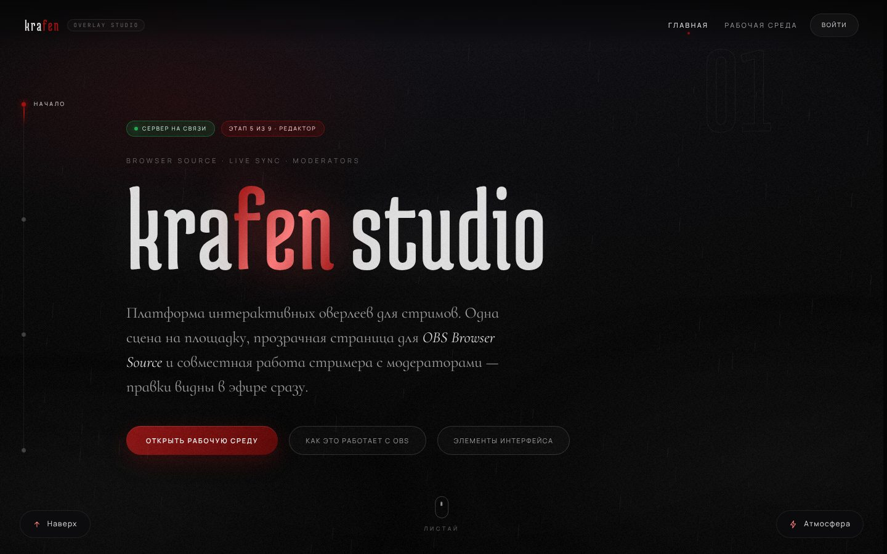

## krafen studio — платформа стрим-оверлеев

Веб-платформа для создания интерактивных оверлеев под OBS Browser Source. Замысел: стример
собирает сцену в редакторе на сайте, один раз вставляет ссылку в OBS, а дальше он и его
модераторы меняют сцену вживую. Внешний вид продолжает [krafen.me](https://krafen.me/).

**Состояние: в разработке, готов этап 4 из 9 (площадки и роли).** Уже можно
зарегистрироваться, создать площадку и собрать команду модераторов по ссылкам-приглашениям.
Редактора и самого оверлея пока нет — они появляются на следующих этапах.



- **[`overlay-platform/`](overlay-platform/)** — код платформы: что уже работает, снимки
  экранов, запуск и проверка.
- [`docs/overlay-platform/ARCHITECTURE.md`](docs/overlay-platform/ARCHITECTURE.md) —
  устройство простыми словами, внешние сервисы и стоимость, план по этапам.

### Быстрый старт

```bash
cd overlay-platform
npm install
npm start                # http://localhost:3000
npm test                 # автоматические проверки
```

Нужен Node.js версии 22.13 или новее. Сторонние сервисы и ключи не требуются.
