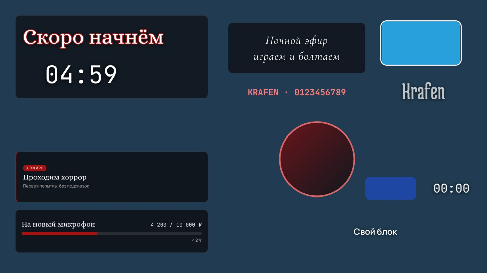
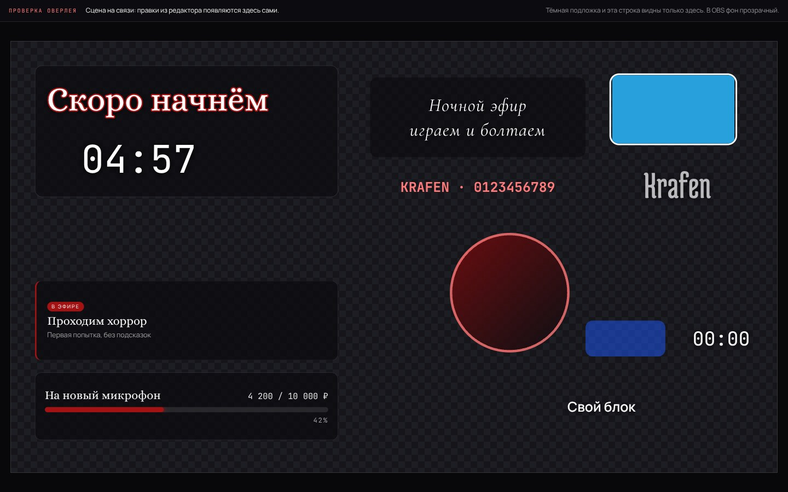
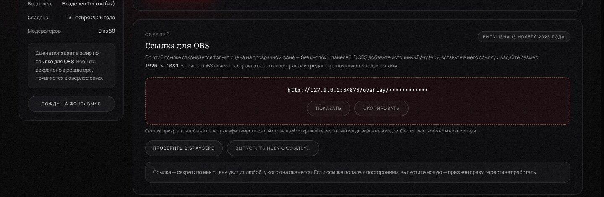
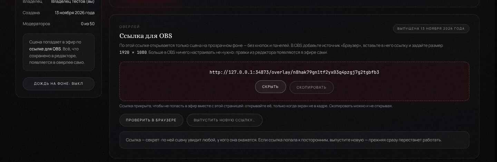

# Платформа стрим-оверлеев: устройство и план

Документ состоит из двух частей. Первая — простыми словами, для владельца проекта.
Вторая — технические решения, для того, кто будет продолжать разработку.

Код платформы лежит в папке [`overlay-platform/`](../../overlay-platform/).

---

## Часть 1. Простыми словами

### Что это будет

Стример регистрируется и создаёт **площадку**. У площадки одна общая **сцена** и своя
ссылка на **оверлей**. Ссылку один раз вставляют в OBS как источник «Браузер». Дальше
стример и его модераторы меняют сцену в редакторе на сайте, а в эфире изменения
появляются сами, без перезагрузки.

### Из чего состоит

| Часть | Что делает |
| --- | --- |
| **Сервер** | Одна программа. Отдаёт страницы, принимает действия пользователей, проверяет права, рассылает изменения. |
| **База данных** | Один файл на том же сервере. Хранит аккаунты, площадки, права модераторов и сцены. |
| **Хранилище файлов** | Папка на том же сервере: загруженные картинки, GIF и видео. |
| **Живой канал связи** | Постоянное соединение между сервером и открытыми страницами. По нему правки долетают до OBS и до других модераторов за доли секунды. |
| **Редактор** | Страница для владельца и модераторов: сцена, слои, свойства объектов. |
| **Оверлей** | Страница для OBS: только сцена на прозрачном фоне, без кнопок и панелей. |

Редактор и оверлей рисуют сцену **одним и тем же кодом**. Поэтому то, что видно
в редакторе, совпадает с тем, что попадает в эфир.

### Как устроен вход

- **Аккаунт — это имя и пароль.** Почта и телефон не нужны.
- **Пароль платформа не хранит.** В базе лежит его необратимый отпечаток: по нему можно
  проверить введённый пароль, но нельзя узнать сам пароль. Посмотреть чужой пароль не может
  никто, включая владельца сервера.
- **Код восстановления** — запасной ключ. Он показывается один раз, сразу после
  регистрации. Если пароль забыт, по коду можно задать новый. Использованный код
  перестаёт действовать, вместо него сразу выдаётся следующий.
- **Если потеряны и пароль, и код**, доступ может вернуть только владелец сервера —
  одной командой (она описана в [README платформы](../../overlay-platform/README.md)).
  Он выдаёт новый код, а пароль человек задаёт сам.
- **Вход запоминается на 30 дней** на каждом устройстве. В кабинете можно закрыть все
  входы разом — например, если входили с чужого компьютера.
- **Подбор пароля ограничен.** После нескольких неудачных попыток вход для этого имени
  с этого адреса на время закрывается.
- **Регистрация открыта для всех.** Её можно закрыть одной настройкой: новые аккаунты
  перестанут создаваться, а существующие продолжат работать.

### Как устроены площадки и команда

- **Площадку создаёт любой вошедший человек** и становится её владельцем. Владелец
  у площадки один. Своих площадок может быть до десяти — например, по одной на канал.
  Площадки, где человек модератор, в этот счёт не входят.
- **Ролей две: владелец и модератор.** Владелец переименовывает и удаляет площадку,
  приглашает и убирает модераторов. Модератор видит площадку и её команду и может сам
  из неё выйти. Со сценой модератор работает наравне с владельцем.
- **Модератор попадает в площадку по ссылке-приглашению.** Владелец создаёт ссылку
  и сам передаёт её человеку — например, личным сообщением. Платформа никому ничего
  не рассылает: почты у неё нет.
- **Ссылка — на одного человека и на семь дней.** Она показывается один раз, в момент
  создания: в базе хранится только её необратимый отпечаток. Пока ссылкой никто
  не воспользовался, владелец может её отозвать. К ссылке можно добавить подпись
  («для Димы») — её видит только владелец, чтобы не путать приглашения.
- **Чтобы принять приглашение, нужен аккаунт.** Гость сначала видит, куда и кто его
  зовёт, затем входит или регистрируется — и возвращается к приглашению.
- **Права проверяет сервер, при каждом действии.** Страница только прячет кнопки,
  которые человеку недоступны. Посторонний получает на любой запрос «площадка
  не найдена» — тот же ответ, что и для площадки, которой нет вовсе. Так нельзя даже
  узнать, существует ли чужая площадка.
- **Открытые страницы обновляются сами.** Владелец сразу видит, что человек принял
  приглашение. Модератор, которого убрали, сразу теряет страницу площадки и редактор.
  То же происходит на всех устройствах человека, если он нажал «выйти на всех
  устройствах» или сменил пароль.
- **Удаление площадки необратимо**, поэтому требует набрать её название. Вместе
  с площадкой исчезают её команда и приглашения.

### Как устроен редактор

- **У площадки одна сцена** размером 1920 × 1080 точек — как кадр трансляции. Тёмная
  клетка в редакторе означает прозрачный фон: в OBS на этом месте будет игра или камера.
- **Сцена состоит из источников.** Их семь типов: текст, картинка, GIF, видео, фигура,
  таймер и виджет. Таймер бывает обратным отсчётом, секундомером или часами. Виджет —
  шкалой цели, бегущей строкой, карточкой эфира или своим блоком на HTML и CSS.
- **Источники лежат слоями.** Верхний в списке закрывает нижние. Любой можно скрыть
  («глаз») и защитить от случайного сдвига («замок»).
- **Двигать и менять размер можно прямо на сцене** — мышью или пальцем — либо точными
  числами в панели свойств. Края сами «прилипают» к краям и серединам сцены и соседних
  источников; клавиша Alt это отключает.
- **Сохранять ничего не нужно.** Каждая правка уходит на сервер сама, в шапке видно:
  «сохранено», «сохраняю…» или «не сохранено». Если пропала связь, правки остаются
  на странице и отправляются, когда связь вернётся. Перед закрытием вкладки
  с неотправленной правкой браузер переспросит.
- **Править сцену можно вместе.** Правка одного человека появляется у остальных сама,
  обычно за долю секунды. Если двое меняют разные свойства одного источника, сохраняются
  обе правки; если одно и то же — остаётся последняя.
- **Файлы** (картинки, GIF, видео) загружаются кнопкой или переносом мышью на сцену.
  Что это за файл, сервер определяет по содержимому, а не по названию. SVG не принимается:
  внутри такого файла может быть программа.
- **Таймеры идут по часам сервера.** Поэтому цифры одинаковы у всех, кто смотрит сцену,
  даже если часы чьего-то компьютера спешат; перезагрузка страницы таймер не сбивает.
- **Свой блок виджета — это оформление, а не программа.** В нём работают HTML и CSS,
  но не скрипты, и он ничего не загружает с чужих сайтов. Причина: сцену видят и другие
  люди — модераторы и OBS стримера, — и чужой код не должен выполняться у них.
- **На телефоне и планшете** сцена остаётся на экране, пока под ней листают слои
  и свойства: видно, что меняется.
- **Чего пока нет:** отмены действия (Ctrl+Z) и одновременной работы «в реальном времени,
  пока тянешь» — итог чужой правки виден, когда источник отпустили; с этапа 7 рядом
  видно и кто его двигает.

### Как сцена попадает в эфир

- **У каждой площадки своя ссылка.** Она появляется вместе с площадкой; вставляют её
  в OBS один раз. Ссылку видит и выпускает заново только владелец площадки — модераторы
  её не видят вовсе.
- **По ссылке открывается только сцена** на прозрачном фоне: ни шапки, ни кнопок,
  ни названия площадки. Всё, что нарисовано на странице, попадает в эфир, поэтому там нет
  ничего лишнего. Пустые места прозрачны — сквозь них видно игру или камеру.
- **В OBS это источник «Браузер»** размером 1920 × 1080. Больше ничего настраивать
  не нужно: правки из редактора появляются в эфире сами, обычно за долю секунды.
- **В эфир уходит только то, что сейчас на сцене.** Скрытые источники по ссылке не видны,
  названия источников и имена людей тоже: ссылка — не вход в аккаунт, а ключ к картинке.
  Файл (картинку или ролик) можно скачать по ссылке, только пока его показывает видимый
  источник.
- **Ссылка — секрет.** Кто её узнал, тот увидит сцену. Поэтому в кабинете она прикрыта
  до нажатия «Показать», а копируется и без этого. Если ссылка попала к посторонним,
  владелец выпускает новую: прежняя перестаёт работать сразу — и в OBS, и в файлах,
  и в живом канале. В OBS после этого сцена гаснет и не возвращается, пока туда
  не вставят новую ссылку.
- **Проверить без OBS** можно кнопкой «Проверить в браузере»: откроется та же сцена,
  но на тёмной подложке «в клетку» и со строкой состояния — в обычной вкладке прозрачный
  фон выглядит белым, и светлые надписи на нём не видны. В самом OBS ни подложки,
  ни строки нет.
- **Если связь пропала,** показанная сцена остаётся на месте, а страница сама повторяет
  запрос; когда связь вернётся, сцена догонит правки. Выдуманный адрес тоже показывает
  пустой прозрачный оверлей, а не страницу «не найдено»: в эфире не должно быть ни ошибок,
  ни лишнего текста.
- **Как в OBS всё выглядит,** проверено на трёх встроенных браузерах сразу — том, что
  в OBS 27.2 (Chromium 95), в OBS 28–30 (Chromium 103) и в обычном свежем. Нужен
  **OBS 27.2 или новее**: в более старых встроенный браузер не умеет того, что нужно
  странице оверлея.

### Внешние сервисы и деньги

**Платных подписок и сторонних сервисов платформа не требует.** База данных, хранение
файлов, вход в аккаунт, живая связь и шрифты работают внутри самой платформы.

Для публикации в интернете понадобятся две вещи, и обе появятся только на последнем этапе:

1. **Сервер (VPS)** — компьютер в дата-центре, на котором платформа работает круглосуточно.
   `krafen.me` уже работает на таком сервере. Платформу можно поставить рядом на тот же
   сервер — тогда дополнительных расходов нет. Отдельный сервер начального уровня
   обычно стоит несколько долларов в месяц (точная цена зависит от хостинга).
2. **Адрес** — например, поддомен вида `overlay.krafen.me`. Поддомен своего домена
   бесплатный. Сертификат для `https` выдаётся бесплатно и автоматически.

Чем придётся платить, если проект вырастет: местом на диске под загруженные видео.
Это решается лимитом на размер файлов и на объём одной площадки.

### Что понадобится от владельца проекта

- **Сейчас — ничего.**
- **По этапу 3** два решения приняты по умолчанию, оба можно пересмотреть:
  регистрация открыта для всех (закрывается настройкой `REGISTRATION=closed`), а забытый
  пароль восстанавливается кодом, без почты. Восстановление по почте потребовало бы
  стороннего почтового сервиса; его можно добавить позже, не ломая существующие аккаунты.
- **По этапу 4** числа и правила выбраны по умолчанию, все можно пересмотреть:
  до 10 своих площадок на аккаунт, до 50 модераторов на площадке, до 20 неиспользованных
  приглашений одновременно, приглашение действует 7 дней. Роль, кроме владельца, одна —
  модератор; ролей «только смотреть» или «второй владелец» нет. Модераторы видят друг
  у друга только отображаемое имя, имя для входа — только владелец.
- **По этапу 5** числа и правила выбраны по умолчанию, все можно пересмотреть:
  - сцена у площадки одна, размер 1920 × 1080; владелец и модераторы правят её на равных;
  - до 100 источников на сцене;
  - до 200 файлов и 200 МБ на площадку; картинка до 10 МБ, GIF до 20 МБ, видео до 50 МБ;
    все площадки сервера вместе — 5 ГБ (меняется настройкой `UPLOADS_TOTAL_LIMIT_MB`);
  - принимаются PNG, JPEG, WebP, GIF, MP4 и WebM; SVG — нет;
  - свой блок виджета — до 20 000 знаков HTML и CSS, без скриптов.
- **По этапу 6** решения приняты по умолчанию, все можно пересмотреть:
  - ссылка одна на площадку, длина — 32 знака своего алфавита (примерно как пароль
    из 24 знаков): подобрать её перебором невозможно;
  - выпускать новые ссылки можно до 30 раз в час на человека — это защита от скрипта,
    а не ограничение работы;
  - минимальная версия OBS — 27.2; в более старых встроенный браузер не справится;
  - вкладку проверки в самом OBS не открыть: страница узнаёт OBS и не показывает её.
- **На этапе 9** — решить, где размещать платформу, и дать доступ к серверу.
  Без разрешения ничего не публикуется.

### План по этапам

| № | Этап | Что появится | Состояние |
| --- | --- | --- | --- |
| 1 | Изучение и план | Разбор обоих репозиториев, устройство платформы, этот документ | готово |
| 2 | Основа | Сервер, база, живой канал связи, шрифты, зерно, общие элементы интерфейса, адаптивная оболочка | готово |
| 3 | Вход | Регистрация, вход, выход, восстановление доступа, кабинет, защита личных страниц | готово |
| 4 | Площадки и роли | Создание площадки, приглашение и отзыв модераторов, проверка прав на сервере | готово |
| 5 | Редактор | Сцена, семь типов источников, слои, перемещение, размеры, свойства, загрузка файлов, сохранение | готово |
| 6 | Оверлей для OBS | Ссылка площадки, прозрачный фон, точное отображение сцены | готово |
| 7 | Синхронизация | Мгновенная передача правок в OBS и между модераторами, переподключение, разбор конфликтов | готово |
| 8 | Проверка и улучшение | Ошибки, безопасность, телефоны, скорость, сверка внешнего вида | готово |
| 9 | Подготовка к запуску | Настройка сервера, резервные копии, публикация, проверка опубликованного | |

---

## Часть 2. Технические решения

### Стек

- **Node.js 22** (ES-модули), **Express** для HTTP, **ws** для WebSocket на том же порту.
- **SQLite** через встроенный модуль `node:sqlite` (`DatabaseSync`), режим `WAL`,
  `foreign_keys = ON`, `busy_timeout`. Нативные npm-аддоны (например `better-sqlite3`)
  не используются: они требуют компиляции и усложняют установку.
  `node:sqlite` в Node 22 помечен как экспериментальный, поэтому вся работа с базой
  изолирована в `src/server/db/` — при необходимости драйвер или СУБД меняются в одном месте.
- **Клиент** — нативные ES-модули и собственная дизайн-система на чистом CSS. Сборщика нет:
  что лежит в `public/`, то и отдаётся браузеру. Страница оверлея при этом остаётся лёгкой.
- **Шрифты** — пакеты `@fontsource/*`, раздаются с нашего сервера (`/vendor/fonts/…`).
  Обращений к Google Fonts и другим CDN нет: оверлей в OBS не зависит от чужих сайтов.
  У *Medula One* нет кириллицы, он используется только для латиницы и цифр.

Та же схема, что у `krafen.me` (`krafenz/SETUP.md`): один процесс под `systemd`,
файл SQLite, перед ним Caddy или Nginx.

### Структура каталога

```
overlay-platform/
  src/server/
    index.js          запуск: читает .env, объясняет причину, если настройки неверны
    app.js            HTTP: заголовки безопасности, страницы и их охрана, API, обработка ошибок
    config.js         настройки из переменных окружения и файла .env
    errors.js         отказ с понятной причиной (короткий код наружу, подробности в журнал)
    text.js           приведение коротких текстов от человека к аккуратному виду
    db/database.js    открытие базы, режимы, миграции, транзакции
    ws/hub.js         живой канал связи: открытые каналы, каналы площадок, пропуска
    workspaces/
      workspaces.js   правила площадок: роли, права, команда, приглашения, пределы
      http.js         адреса /api/workspaces и /api/invites (без единой проверки прав внутри)
    scene/
      scene.js        правила сцены: источники, файлы, пределы, таймер, версия сцены,
                      что видно по ссылке оверлея (только то, что сейчас в эфире)
      storage.js      файлы на диске: приём, проверка размеров, уборка
      http.js         адреса /api/workspaces/:id/scene и /media (без проверок прав внутри)
    overlay/
      http.js         адреса /api/overlay/<ссылка> и /overlay/<ссылка>/media/<файл>:
                      передают ссылку правилам, сами не проверяют ничего
    auth/
      accounts.js     правила аккаунтов: регистрация, вход, сеансы, восстановление, лимиты
      http.js         адреса /api/auth и /api/account, охрана страниц, защита от чужих сайтов
      passwords.js    scrypt, очередь тяжёлых вычислений, требования к паролю
      tokens.js       ключ сеанса, код восстановления, случайные номера и ссылки, отпечатки
      cookies.js      cookie сеанса и её режимы
      rate-limit.js   счётчики попыток
  src/tools/
    account.js        помощник владельца сервера (npm run account)
  public/
    styles/           tokens → atmosphere → components → layout; scene.css — вид источников
                      на сцене (общий для редактора и оверлея), editor.css — страница
                      редактора, overlay.css — страница оверлея и её вкладка проверки
    js/core/          atmosphere.js (зерно, дождь), ui.js (окна, уведомления, вкладки),
                      api.js (запросы и живой канал), session.js (кто вошёл, тексты ошибок),
                      forms.js (поля и формы), format.js (даты и числа словами),
                      cabinet.js (общее для страниц кабинета)
    js/scene/         сцена — общий код для браузера и сервера: описания семи типов
                      источников (sources/), проверка настроек (schema.js), счёт таймера
                      (timer.js), распознавание файлов (sniff.js), отрисовка (view.js),
                      часы сервера (clock.js), свой блок виджета (html-block.js)
    js/editor/        редактор: копия сцены и очередь команд (store.js), сцена с рамкой
                      выделения (stage.js), слои, панель свойств, окно файлов
    js/pages/         скрипты конкретных страниц
    index.html, app.html, workspace.html, editor.html, overlay.html, invite.html,
    login.html, register.html, recover.html, 404.html
  test/               автоматические проверки (node:test)
  data/               база и загрузки (в репозиторий не попадают)
```

### Дизайн-система

Источник — `krafenz/style.css` и `krafenz/app.js`.

- **Палитра и шрифты** перенесены без изменений (`--void`, `--abyss`, `--silver*`,
  `--crimson*`, `--glass`, `--glass-border`, `--line`; Medula One, Alice, Cormorant Infant,
  Manrope, JetBrains Mono). Совпадение значений проверяется тестом.
- **Зерно** создаётся тем же алгоритмом, что в оригинале: холст 128×128, линейный
  конгруэнтный генератор с тем же начальным числом, затем плитка через `background-image`
  с непрозрачностью `0.038`. Готовых картинок шума в проекте нет — это проверяется тестом.
  Одно отличие от оригинала: холст создаётся с пометкой `willReadFrequently` и поэтому
  живёт в обычной памяти, а не в видеокарте. Рисунок тот же, но страница при открытии
  больше не ждёт видеокарту, чтобы забрать готовую плитку. В проверочном браузере без
  видеокарты это ожидание занимало от 0,4 до 4,5 секунды на каждой странице, теперь —
  меньше миллисекунды.
- **Слои атмосферы** идут в порядке оригинала: свечение → содержимое → туман → дождь →
  виньетка → зерно → вспышка.
- **Два режима.** На обычных страницах атмосфера лежит поверх содержимого, как на
  `krafen.me`. В рабочей среде (`body.studio`) туман, дождь и виньетка уходят под панели,
  дождь по умолчанию выключен и в выключенном состоянии не рисуется вовсе. Зерно остаётся
  в обоих режимах.
- **Размытие фона** (`backdrop-filter`) оставлено только там, где оно есть в оригинале:
  шапка, док, окна, уведомления, мобильное меню. У карточек размытия нет — так же, как
  в оригинале; это важно для скорости на слабых машинах и в OBS.
- Страница оверлея для OBS атмосферу не подключает вообще: там только сцена.

### Модель данных

Сейчас в базе служебные таблицы (`schema_migrations`, `system_settings`), таблицы
аккаунтов (миграция `002_accounts`), площадок (`003_workspaces`), сцены (`004_scene`)
и ссылки оверлея (`005_overlay_link`).
Остальное добавляется миграциями на своих этапах. Применённая миграция не меняется
и не выполняется повторно; база прошлого этапа при запуске достраивается сама
(проверяется тестом).

| Таблица | Назначение | Этап |
| --- | --- | --- |
| `users` | аккаунты: имя, оно же в нижнем регистре (уникальное), отображаемое имя, отпечаток пароля, отпечаток кода восстановления, даты | 3 — есть |
| `sessions` | сеансы входа: отпечаток ключа, пользователь, даты создания, последнего посещения и окончания | 3 — есть |
| `workspaces` | площадки: номер для адреса, владелец, название, даты; с этапа 5 — размер сцены и номер её версии; с этапа 6 — ссылка оверлея и дата её выпуска | 4 — есть |
| `workspace_members` | модераторы площадок: пара «площадка + человек» и дата вступления | 4 — есть |
| `workspace_invites` | приглашения: номер, площадка, отпечаток ссылки, подпись, срок, кто и когда принял | 4 — есть |
| `sources` | источники сцены: тип, название, положение, размер, прозрачность, порядок, видимость, защита, файл, настройки типа и состояние (ход таймера) | 5 — есть |
| `media_files` | загруженные файлы: площадка, кто загрузил, вид, тип, размер, ширина и высота, название | 5 — есть |

- **Владелец записан в самой площадке** (`workspaces.owner_id`), а в `workspace_members`
  лежат только модераторы. Поэтому владелец у площадки всегда ровно один, а отдельного
  столбца «роль» нет: роль следует из того, где человек записан.
- **Наружу уходят только случайные номера** (`public_id`, 12 знаков), а не порядковые
  номера строк: по адресу площадки нельзя ни перебрать соседние, ни узнать, сколько их всего.
- **Принятое приглашение не удаляется**, пока человек остаётся модератором: по нему
  владелец видит, по какой ссылке тот вошёл. Когда модератор уходит или его убирают,
  запись исчезает вместе с ним.
- **Удаление каскадное:** вместе с площадкой удаляются её модераторы и приглашения,
  вместе с аккаунтом — его площадки и участие в чужих.
- У площадки ровно одна сцена, поэтому отдельной таблицы сцен нет: источники привязаны
  прямо к площадке, а размер сцены и номер её версии лежат в `workspaces`
  (`scene_width`, `scene_height`, `scene_version`).
- Ссылка оверлея лежит в `workspaces.overlay_token` вместе с датой выпуска
  (`overlay_token_at`) и уникальна индексом: две площадки с одной ссылкой невозможны.
  Хранится она как есть, а не отпечатком, как ключ сеанса: сервер должен находить
  площадку по ссылке из адреса, а перебирать 160 бит бессмысленно. У площадок этапа 5
  ссылка появляется при обновлении базы — сразу своя у каждой.
- Настройки источника и ход таймера хранятся как JSON: у каждого типа они свои, и новый
  тип не требует менять таблицу. При чтении запись проверяется заново: значение, которого
  нет или которое перестало быть допустимым, заменяется значением по умолчанию.
- Сам файл лежит на диске (`data/uploads/<площадка>/<номер файла>`), в базе — только
  сведения о нём. Источник ссылается на файл. Файл, который показывает хотя бы один
  источник, удалить нельзя (`409 media_in_use`): сначала его убирают из источников.
  Файл принадлежит площадке, а не тому, кто его загрузил: модератор ушёл — файл остался.
- Вместе с площадкой удаляются её источники и записи о файлах, а следом — папка с файлами.

### Площадки и роли (этап 4)

Вся логика — в `workspaces/workspaces.js`. Каждая функция получает «кто просит»
и «какую площадку» и первым делом определяет роль человека одним запросом к базе.
В `workspaces/http.js` проверок прав нет вовсе: каждый адрес лишь передаёт в правила
пару «человек из сеанса входа + номер площадки из адреса». Так проверку невозможно
забыть, добавляя новый адрес; это закреплено тестом.

| Действие | Адрес | Владелец | Модератор | Посторонний |
| --- | --- | --- | --- | --- |
| Список своих площадок | `GET /api/workspaces` | да | да | — |
| Создать площадку | `POST /api/workspaces` | любой вошедший | | |
| Площадка и команда | `GET /api/workspaces/:id` | да | да, без имён для входа и приглашений | 404 |
| Переименовать | `PATCH /api/workspaces/:id` | да | 403 | 404 |
| Удалить | `POST …/:id/delete` | да, с названием | 403 | 404 |
| Выйти из команды | `POST …/:id/leave` | 409 | да | 404 |
| Убрать модератора | `POST …/:id/members/remove` | да | 403 | 404 |
| Создать приглашение | `POST …/:id/invites` | да | 403 | 404 |
| Отозвать приглашение | `POST …/:id/invites/:inviteId/revoke` | да | 403 | 404 |
| Пропуск в живой канал | `POST …/:id/live` | да | да | 404 |
| Ссылка оверлея | в ответе `GET /api/workspaces/:id` | да | — | — |
| Выпустить новую ссылку | `POST …/:id/overlay/renew` | да | 403 | 404 |
| Посмотреть приглашение | `GET /api/invites/:token` | любой, включая гостя | | |
| Принять приглашение | `POST /api/invites/:token/accept` | любой вошедший, кроме владельца этой площадки | | |

Отказ — всегда `{ ok: false, error: "<код>" }`; текст для человека подбирает страница
(`describeError` в `session.js`), для каждого кода есть свой текст — это проверяется тестом.

**Страницы.** `/app/w/<номер>` — страница площадки, одна на все площадки; в самой
странице данных нет, она запрашивает их после загрузки. `/app/w/<номер>/editor` —
редактор сцены (этап 5), устроен так же. `/invite/<ссылка>` — страница
приглашения, открыта и гостю. Разделы кабинета записаны в адресе (`/app#plan`): на раздел
можно дать ссылку, а после обновления страницы открыт он же. Переключение разделов
не копится в истории браузера — «Назад» уводит из кабинета на предыдущую страницу.

**Живой канал площадки.** Адрес — `/ws?channel=workspace:<номер>&ticket=<пропуск>`.

- Cookie при подключении не участвуют. Страница сначала получает пропуск обычным
  запросом (`POST …/live`): там проверяются вход, права и то, что запрос пришёл с нашего
  сайта. Пропуск одноразовый, действует 30 секунд и только для своей площадки; у одного
  входа ждут использования не больше четырёх.
- По каналу идут только сигналы `workspace:changed { what, mine }` — «на площадке
  изменилось то-то». Данных в них нет: получив сигнал, страница заново запрашивает
  площадку обычным запросом, где права проверяются как всегда. Сигналы о приглашениях
  получает только владелец. С этапа 5 тем же сигналом сообщается об изменении сцены
  (`what: "scene"`, к нему добавлены номер версии и метка вкладки-автора).
- Права проверяются перед каждой отправкой и сразу, как только заканчивается чей-либо
  вход. Кому доступа больше нет, тот получает `denied`, и соединение закрывается.
- После обрыва страница берёт новый пропуск и перечитывает площадку целиком: всё, что
  изменилось за время разрыва, она получает разом.

**Пределы** (значения по умолчанию, `DEFAULT_WORKSPACE_LIMITS`):

| Что ограничено | Значение |
| --- | --- |
| Своих площадок у одного аккаунта | 10 |
| Модераторов на площадке | 50 |
| Неиспользованных приглашений на площадке | 20 |
| Срок действия приглашения | 7 дней |
| Название площадки, подпись приглашения | до 40 знаков |
| Создание площадок одним человеком | 20 в час |
| Создание приглашений одним человеком | 60 в час |
| Выпуск новых ссылок оверлея | 30 в час |

Название площадки уникально у одного владельца без учёта регистра: иначе их не отличить
в списке. У разных владельцев названия могут совпадать.

### Сцена и редактор (этап 5)

Правила — в `scene/scene.js`. Как и у площадок, каждое действие первой строкой «входит
в площадку» (`workspaces.enter`): это та же проверка, что у страницы площадки. Отдельного
списка прав у сцены нет: кто видит площадку, тот и правит сцену. В `scene/http.js`
проверок прав нет вовсе — это закреплено тестом.

| Действие | Адрес | Владелец и модератор | Посторонний | Гость |
| --- | --- | --- | --- | --- |
| Сцена целиком | `GET /api/workspaces/:id/scene` | да | 404 | 401 |
| Новый источник | `POST …/scene/sources` | да | 404 | 401 |
| Изменить источник | `PATCH …/scene/sources/:sid` | да | 404 | 401 |
| Удалить, скопировать, переставить | `POST …/sources/:sid/delete`, `/duplicate`, `/move` | да | 404 | 401 |
| Команда таймеру | `POST …/sources/:sid/command` | да | 404 | 401 |
| Загрузить файл | `POST …/scene/media` | да | 404 | 401 |
| Удалить файл | `POST …/scene/media/:fid/delete` | да | 404 | 401 |
| Сам файл | `GET /media/:id/:fid` | да | 404 | 404 |

Чужая площадка, как и прежде, неотличима от несуществующей; чужой файл — от файла,
которого нет.

**Версия сцены и оповещение.** Каждое сохранённое изменение увеличивает
`scene_version` на единицу — в той же транзакции, что и само изменение. После этого
открытые страницы площадки получают по живому каналу сигнал
`workspace:changed { what: "scene", mine, version, origin }`. Данных в сигнале нет: страница
перечитывает сцену обычным запросом, где права проверяются как всегда. `origin` — метка
вкладки, приславшей правку (заголовок `X-Client-Id`): по ней вкладка узнаёт свою же
правку и не перечитывает сцену зря. Это не право и не секрет. Правка, которая ничего
не изменила, версию не трогает и никого не оповещает.

**Как страница отправляет правки** (`js/editor/store.js`):

- команды идут строго по одной, в том порядке, в каком человек их сделал;
- правки одного источника, сделанные подряд, склеиваются в одну; пока источник тянут,
  на сервер не уходит ничего — уходит итог, когда его отпустили;
- ползунки и переключатели отправляются через 0,35 секунды после последнего движения;
  набранное с клавиатуры — после паузы в 0,9 секунды или сразу, когда человек вышел
  из поля: иначе в эфире мелькали бы недописанные значения;
- ответ сервера не затирает то, что человек успел изменить, пока шёл запрос;
- сервер не ответил — правки остаются на странице, отправка повторяется сама через 2, 4,
  8 и далее каждые 15 секунд, и сразу — когда браузер сообщает, что сеть вернулась;
- вкладку сворачивают или закрывают — неотправленное уходит запросом, который браузер
  доводит до конца и после закрытия страницы;
- сцена стала недоступна (площадку удалили, человека убрали) — копия сцены со страницы
  убирается целиком.

**Защита от сдвига действует и на сервере.** Пока она включена, положение и размер
не меняются — даже с чужой страницы, где источник ещё выглядит свободным (`409
source_locked`). Исключение — правка, которая сама переключает защиту: страница склеивает
несколько действий подряд («снял защиту, подвинул, вернул»), и такая правка проходит целиком.

**Файлы.**

- Вид файла определяется по первым 64 байтам содержимого (`js/scene/sniff.js`), одной
  и той же функцией на странице и на сервере. Страница проверяет файл до отправки, чтобы
  сразу сказать, что не так; решает сервер — по тем байтам, которые реально пришли.
  Название и заявленный тип ни на что не влияют.
- Принимаются PNG, JPEG, WebP, GIF, MP4 и WebM. Из семейства MP4 отклоняются MOV, HEIC,
  AVIF и звук без видео. SVG не принимается.
- У картинок проверяются размеры в точках: не больше 8192 по стороне и 40 мегапикселей.
  Огромная по размерам картинка весит мало, но при показе заняла бы гигабайты памяти.
- Файл пишется во временную папку (`uploads/.incoming/`) и переносится на место, только
  когда принят целиком. Место на площадке и на сервере проверяется до приёма и ещё раз
  перед сохранением: два одновременных файла не могут вместе превысить предел.
- Отдаётся файл только участнику площадки, с типом из базы и с запретом браузеру что-либо
  в нём выполнять (`Content-Security-Policy: default-src 'none'; sandbox`, `nosniff`).
  Браузер хранит файл, но перед каждым показом спрашивает сервер — права проверяются заново.
- Раз в час и при каждом запуске сервер убирает недокачанное и файлы, о которых база
  не знает (например, оставшиеся после сбоя), если им больше часа: свежий файл может
  ещё загружаться.

**Сроки.** Загрузка, по которой минуту не пришло ни байта, обрывается и освобождает своё
место. На запрос целиком отводится 30 минут вместо обычных для Node.js пяти: видео
в 50 МБ по связи 1 Мбит/с идёт почти семь минут. При остановке сервера идущим запросам
даётся 5 секунд, затем соединения закрываются, недокачанные файлы убираются, база
закрывается.

**Таймер.** Он нигде не «тикает». В базе лежит только то, от чего считать: идёт ли он,
сколько было на счётчике в момент пуска и когда его пустили — по часам сервера
(`js/scene/timer.js`). Что показать сейчас, каждая страница вычисляет сама. Страница
знает, на сколько часы сервера расходятся с часами устройства: разница уточняется
при каждом чтении сцены и по ответам живого канала (`js/scene/clock.js`). Пуск, пауза
и сброс — команды серверу; время в них подставляет он.

**Свой блок виджета** (`js/scene/html-block.js`) — единственное место, где разметку
пишет человек. Защита в три слоя:

1. рамка создаётся с пустой пометкой `sandbox`: скрипты не выполняются, формы
   не отправляются, а для браузера содержимое — посторонний сайт без имени;
2. рамка наследует политику загрузки страницы: картинки, стили, шрифты и видео — только
   с нашего сервера, с чужих адресов не загружается ничего;
3. из кода заранее убирается то, что политика не покрывает: `<link>`, `<meta>`, `<base>`,
   вложенные рамки, ссылки.

От блока со скриптами (в рамке «без доступа к сайту») отказались после проверки
в браузере: скрипт в такой рамке всё равно узнавал сетевой адрес компьютера через прямое
соединение (WebRTC), и надёжно запретить это браузер не позволяет.

**Раскладка редактора.** Три вида: широкий экран — слои, сцена и свойства в три колонки
во всю высоту окна; средний (до 1180 точек) — сцена сверху, под ней слои и свойства рядом;
телефон (до 760) — под сценой слои и свойства по очереди.

- На среднем экране и телефоне сцена «прилипает» под шапкой сайта. Страница сообщает
  браузеру, сколько места сверху занято (`scroll-padding-top`), чтобы поле, в которое
  человек перешёл, не оказалось под сценой. Сцена не «прилипает» в двух случаях: окно
  ниже 540 точек (телефон боком) и под сценой остаётся меньше 160 точек (открыта экранная
  клавиатура) — тогда она прокручивается вместе со страницей.
- Шапка редактора — сетка с постоянным местом под значки состояния: она не
  перестраивается, когда «сохранено» сменяется на «сохраняю…» или идёт загрузка файла.
- Прокруткой окна управляет только `html`. Запрет прокрутки вбок, стоявший ещё
  и у `body`, делал `body` отдельной областью прокрутки — из-за этого не работали
  `position: sticky` и запрет прокрутки под открытым окном. Место под полосу прокрутки
  занято всегда (`scrollbar-gutter: stable`): страница не сдвигается вбок, когда полоса
  исчезает.

**Пределы** (значения по умолчанию, `DEFAULT_SCENE_LIMITS` и константы в `scene.js`):

| Что ограничено | Значение |
| --- | --- |
| Источников на сцене | 100 |
| Название источника | до 40 знаков |
| Положение источника | от −8192 до 8192 точек |
| Размер источника | от 8 до 8192 точек |
| Файлов на площадке | 200 |
| Место под файлы одной площадки | 200 МБ |
| Место под файлы всего сервера | 5 ГБ (`UPLOADS_TOTAL_LIMIT_MB`) |
| Картинка (PNG, JPEG, WebP) | до 10 МБ, до 8192 точек по стороне, до 40 мегапикселей |
| GIF | до 20 МБ |
| Видео (MP4, WebM) | до 50 МБ |
| Название файла | до 80 знаков |
| Свой блок виджета | до 20 000 знаков |
| Загрузок одновременно | 2 у человека, 8 на сервере |
| Загрузок за 10 минут | 60 у человека |
| Команд сцене за минуту | 600 у человека на площадке |
| Тело команды | до 256 КБ |

### Оверлей для OBS (этап 6)

Оверлей — это страница, которую OBS открывает как источник «Браузер». Она открыта без
входа: площадку ей открывает ссылка из адреса. Поэтому всё, что по ссылке можно узнать,
проверяется отдельно, а сама ссылка — такой же секрет, как пароль.

**Ссылка.** 32 знака из того же алфавита, что номера площадок (без `i`, `l`, `o`, `u`) —
160 бит, примерно как пароль из 24 знаков; подобрать её перебором невозможно. У приглашения
длина другая (26 знаков), чтобы одну ссылку нельзя было принять за другую. Ссылка одна
на площадку и появляется вместе с ней; у площадок прошлых этапов она создаётся при
обновлении базы (`005_overlay_link`). Выпускает новую только владелец, до 30 раз в час;
прежняя перестаёт работать сразу.

Ссылка хранится в базе как есть (не отпечатком): по ней нужно находить площадку при каждом
запросе из OBS, а отпечаток потребовал бы перебора всех площадок на каждый запрос.

**Что видно по ссылке.**

| Действие | Адрес | Что нужно |
| --- | --- | --- |
| Сцена для эфира | `GET /api/overlay/<ссылка>` | только ссылка |
| Файл, который сейчас в эфире | `GET /overlay/<ссылка>/media/<файл>` | только ссылка |
| Сама страница | `GET /overlay/<ссылка>` | ничего: страница одна на всех |

Ответ сцены — `{ scene: { width, height, version }, sources, serverTime }` и больше ничего:

- только **видимые** источники (`visible = 1`), снизу вверх — как на сцене;
- в источнике нет названия и защиты от сдвига, а также номера слоя: редактору они нужны,
  эфиру — нет. Нет и номера площадки: оверлею нечего с ним делать;
- настройки, которые сейчас ни на что не влияют (`when` в описании поля: цвет обводки
  без обводки, текст бегущей строки у виджета-шкалы, код своего блока у карточки), заменены
  значениями по умолчанию (`onAirSettings` в `scene/scene.js`). Иначе по ссылке можно было бы
  прочитать заготовки, которых на сцене не видно;
- `serverTime` — часы сервера: по ним оверлей считает таймеры так же, как редактор;
- файла (`file`) нет вовсе у источников без файла, а сам файл отдаётся, только пока его
  показывает **видимый** источник. Файл из библиотеки по ссылке не скачать, даже зная номер.

Ни названия площадки, ни имён людей, ни списка файлов, ни пределов по ссылке не уходит.
Проверки прав в `overlay/http.js` нет вовсе: каждый адрес передаёт ссылку в
`workspaces.enterOverlay` (действует ли она) и в правила сцены (что именно видно) —
это закреплено тестом.

**Чем ссылка не является.** Она не даёт ни входа, ни прав: по ней нельзя ни править сцену,
ни управлять таймером, ни выпустить новую ссылку. Ни один адрес оверлея не читает
и не выставляет cookie, сеансы входа не трогаются, а ответы не запоминаются браузером
(`Cache-Control: no-store`): ссылку могут отменить в любой момент.

**Страница оверлея** (`public/overlay.html`, `js/pages/overlay.js`, `styles/overlay.css`).
Одна на все площадки: ни сцены, ни ссылки в разметке нет — сцену присылает сервер по ссылке
из адреса. На ней нет ни зерна, ни дождя, ни шапки, ни кнопок: всё нарисованное попадает
в эфир. Подключаются только шрифты, `scene.css` (тот же вид источников, что в редакторе)
и `overlay.css`. Пустые места прозрачны.

- **Всё, что начинается с `/overlay`, отвечает этой страницей** — и адрес с ошибкой тоже
  (с кодом 404, чтобы это видели поисковые машины и проверки). Обычная страница «не найдено»
  в OBS оказалась бы в эфире поверх трансляции, а пустой оверлей просто ничего не рисует.
  Не-GET запросы страницей не подменяются.
- **Ссылка из адреса страницы не утекает:** `Referrer-Policy: no-referrer`, `no-store`,
  `<meta name="referrer" content="no-referrer">`, `noindex`.
- **Сцена собирается тем же модулем, что в редакторе** (`js/scene/view.js`), и не зависит
  от страницы: цвет, шрифт, межстрочный интервал и отступы `.kf-scene` в `scene.css` заданы
  явно, переменные — только свои (`--kf-*`). Без этого надпись без собственного цвета была
  бы в редакторе светлой, а в эфире чёрной.
- **Пока сцена не собрана и шрифты не догружены, её не видно** (`html.overlay-ready`):
  в эфир не попадает ни полусобранная сцена, ни надпись запасным шрифтом.
- **Вкладка проверки** — `/overlay/check#<ссылка>`: та же сцена на тёмной подложке «в клетку»
  со строкой состояния. Ссылка стоит после `#` (на сервер эта часть адреса не уходит),
  а страница сразу убирает её из адресной строки через `history.replaceState` и держит
  в памяти вкладки. В самом OBS вкладки проверки нет: страница узнаёт OBS по `window.obsstudio`
  и показывает только сцену.
- **Связь пропала** — сцена остаётся на экране, запрос повторяется через 1, 2, 4, 8, 15 секунд.
  **Ссылку отменили** (ответ `overlay_not_found`) — сцена убирается целиком: ролики
  останавливаются, звук гаснет, канал закрывается, и страница больше ни о чём не спрашивает.
  Ждать и показывать «ошибку» в эфире нечего.

**Живой канал оверлея** — `/ws?channel=overlay&key=<ссылка>`. Имя канала назначает сервер
(`overlay:<номер площадки>`), попросить его по имени нельзя: всё, что начинается с `overlay`,
пускается только по действующей ссылке. По каналу идёт один сигнал — `overlay:changed
{ version }`: ни кто менял, ни с какой страницы, ни что именно. Остальные события площадки
(название, команда, приглашения) до оверлея не доходят, но **перед каждой отправкой ссылка
проверяется заново**: после выпуска новой ссылки или удаления площадки канал закрывается
(`denied`, код 4403) — это и есть сигнал погасить сцену.

- Оверлеев одной площадки на канале не больше 20: стримеру хватает нескольких (OBS, вкладка
  проверки, второй компьютер). Лишним сервер отвечает `busy` (код 4429) — это не отказ
  в доступе: сцена им всё равно показывается, они сверяются запросами, а в канал страница
  стучится снова через минуту.
- `pong` в канале оверлея не показывает, сколько страниц сейчас на связи (`activeClients`):
  это не его дело.
- Пока канал на связи, страница сверяется запросом раз в 30 секунд (сигнал мог потеряться);
  без канала — раз в 5 секунд.

**Совместимость с OBS.** Нужен **OBS 27.2 или новее**: в нём встроен Chromium 95. В OBS 28–30 —
Chromium 103, в свежих — новее. Код страницы оверлея не использует возможностей новее
Chromium 86 (`replaceChildren`, `?.`, `??`, `gap` во flex). Проверено в трёх сборках
Chromium сразу: 153, 103 и 92 (чуть старше, чем в OBS 27.2) — вид сцены совпадает с редактором
до последней точки во всех трёх.



*Так выглядит оверлей в OBS. Светлое — сама сцена; фон вокруг добавлен для наглядности,
в эфире его нет: там на этом месте игра или камера.*



*Вкладка проверки: та же сцена, но на тёмной подложке «в клетку» и со строкой состояния —
в обычной вкладке прозрачный фон выглядит белым, и светлые надписи на нём не видны.*

**На странице площадки** карточка «Ссылка для OBS»:

- ссылку видит только владелец; модератору карточка объясняет, что ссылка у владельца;
- по умолчанию ссылка прикрыта (`/overlay/••••••••••••`): кабинет нередко открыт на том же
  экране, который идёт в эфир. «Показать» открывает её, «Скопировать» копирует и прикрытую;
  ушли со вкладки или пришла новая ссылка — она снова прикрыта;
- «Проверить в браузере» открывает вкладку проверки (она не связана с кабинетом: `opener`
  обнуляется); «Выпустить новую ссылку…» сначала объясняет последствия в окне подтверждения.



*Ссылка в кабинете прикрыта: кабинет нередко открыт на том же экране, который идёт в эфир.*



*После «Показать» — видна целиком; копируется и без этого.*

### Источники

Каждый тип — отдельный модуль в `public/js/scene/sources/`. В нём: название и значок,
размер нового источника, описание настроек (вид поля, границы, значение по умолчанию,
подпись, условие показа) и отрисовка на сцене. У типов с файлом указано, какие файлы
подходят; у таймера — команды и счёт.

По одному и тому же описанию настроек работают три места: сервер проверяет присланное,
панель свойств строит поля, сцена рисует. Поэтому новый тип добавляется одним модулем:
ни сервер, ни редактор при этом не переписываются.

Набор: `text`, `image`, `gif`, `video`, `shape`, `timer`, `widget`.

### Безопасность

Сделано на этапе 2:

- `Content-Security-Policy`: скрипты, стили, шрифты, картинки, видео, вложенные рамки
  и соединения — только со своего адреса; встроенных скриптов на страницах нет
  (проверяется тестом).
- Запрета на показ во фрейме нет намеренно: оверлей открывается внутри OBS.
- Наружу при ошибках уходит только короткий код; подробности остаются в журнале сервера.
- Из каталога шрифтов отдаются только `.css` и `.woff/.woff2`.
- Адресу посетителя из заголовков прокси сервер верит, только если прокси стоит на этой же
  машине (`TRUST_PROXY=loopback`).

Сделано на этапе 3:

- **Пароли** — `crypto.scrypt` (N=32768, r=8, p=3: около 0,2 с и 32 МБ на проверку),
  случайная соль, сравнение через `timingSafeEqual`. Параметры записаны рядом с отпечатком
  (`scrypt$N$r$p$соль$ключ`): если их усилить, запись пользователя обновится при следующем
  входе. Одновременно считаются не больше двух паролей, очередь ограничена — лишние запросы
  получают отказ `503`, а не занимают память сервера.
- **Требования к паролю** — от 8 до 200 символов; самые ходовые пароли, цепочки вида
  `12345678` и пароли, повторяющие имя, отклоняются. Состав символов не навязывается.
- **Имя пользователя** — латиница, цифры и `_`, от 3 до 24 символов, уникально без учёта
  регистра; служебные имена (`admin`, `support`, `overlay`…) заняты. Отображаемое имя —
  произвольный текст до 40 символов без невидимых и управляющих знаков.
- **Сеансы** — случайный ключ (256 бит) в cookie, в базе только его SHA-256. Срок — 30 дней
  с последнего посещения, не больше 20 входов на аккаунт, истёкшие удаляются раз в час.
  Смена пароля закрывает остальные входы, восстановление по коду — все. Новый вход в том же
  браузере заменяет прежний.
- **Cookie** — `HttpOnly; SameSite=Lax; Path=/`. По `https` добавляются `Secure` и имя
  с приставкой `__Host-`. Скрипты страниц ключ не видят и нигде его не хранят.
  Режим `SESSION_COOKIE_MODE=embedded` (`SameSite=None; Secure; Partitioned`) существует
  только для предпросмотра внутри чужой страницы.
- **Код восстановления** — 20 символов из 30-значного алфавита без похожих знаков
  (около 98 бит), в базе только SHA-256. Показывается один раз, после использования заменяется.
- **Запросы с чужих сайтов** — для всех `/api` любой запрос, меняющий данные, проверяется
  по `Sec-Fetch-Site`, а в старых браузерах по `Origin`; команды аккаунта принимаются только
  в `application/json`. `SameSite=Lax` — второй слой той же защиты.
- **Ограничение попыток** (счётчики в памяти сервера): неудачный вход или восстановление —
  8 за 15 минут на пару «адрес + имя», 30 за 15 минут на адрес, 100 за час на имя;
  регистрация — 5 аккаунтов в час с адреса; неверный текущий пароль в кабинете — 8 за 15 минут.
  Адреса IPv6 считаются по подсети /64. Ответ — `429` с указанием, сколько ждать.
- **Одинаковые ответы** — «нет такого имени» и «неверный пароль» неотличимы ни по тексту,
  ни по времени ответа (для несуществующего имени выполняется такая же по длительности
  проверка вхолостую).
- **Страницы** — `/app` без входа ведёт на `/login?next=…`; после входа человек возвращается
  по `next`, но только внутрь этого же сайта. Страницы входа и кабинета не кешируются
  (`no-store`). Текст от пользователя попадает на страницу только через `textContent`;
  разметку из строк страницы не собирают (проверяется тестом). Единственное место, где
  разметку пишет человек, — свой блок виджета; он показывается в рамке без скриптов
  (этап 5).
- **Владелец сервера** не может узнать пароль; он может лишь выдать новый код
  восстановления (`npm run account -- new-code <имя>`).

Сделано на этапе 4:

- **Права** проверяются на сервере при каждом действии: владелец, модератор этой площадки
  или никто. Проверка стоит в одном месте — в правилах, а не в обработчиках адресов.
- **Чужая и несуществующая площадка неотличимы**: один и тот же ответ `404
  workspace_not_found` — на просмотр, на любое действие и на запрос пропуска в живой канал.
  Страница площадки для постороннего совпадает байт в байт со страницей для участника:
  данных в ней нет.
- **Ссылка-приглашение** — 26 случайных знаков (130 бит), в базе только SHA-256.
  Действует 7 дней и для одного человека; из двух одновременных нажатий «Принять»
  срабатывает одно. Отозванная, просроченная, использованная и выдуманная ссылки выглядят
  одинаково. Странице приглашения запрещено сообщать свой адрес другим сайтам
  (`Referrer-Policy: no-referrer`), и браузер её не запоминает (`no-store`).
- **Номера площадок и приглашений** — 12 случайных знаков (60 бит). Это не секрет,
  а защита от перебора по порядку: доступ даёт не знание номера, а роль.
- **Кто видит что.** Имена для входа, подписи приглашений и сами приглашения сервер
  отдаёт только владельцу. Модератор получает о команде только отображаемые имена.
  Гость по ссылке-приглашению видит название площадки и имя владельца, но не её номер.
- **Живой канал площадки** открывается по одноразовому пропуску, а не по cookie.
  Поэтому чужой сайт не может подключиться от имени вошедшего человека, а проверка
  не зависит от того, как браузер обращается с cookie при установке соединения.
  Права перепроверяются перед каждой отправкой.
- **Закрытый вход отключается сразу.** Выход, «выйти везде», смена пароля,
  восстановление доступа и повторный вход в том же браузере — после любого из них
  открытые страницы площадок этого входа немедленно теряют канал и уходят на страницу
  входа. Вход, у которого просто вышел срок, перестаёт получать сообщения в тот же
  момент (права проверяются перед каждой отправкой), а само соединение закрывается
  при ближайшей уборке устаревших записей — не позже чем через час.
- **Удаление площадки** требует её названия в самом запросе: ошибка в адресе или
  случайное нажатие ничего не удалят.
- **Тексты от людей** (названия, подписи) приводятся к одной строке без невидимых
  и управляющих знаков и попадают на страницу только через `textContent`.
- **Запрос страницы к серверу** ждёт ответа не дольше 20 секунд: при «зависшей» связи
  человек видит «нет связи с сервером», а кнопка не остаётся нажатой навсегда.

Сделано на этапе 7:

- **Изменение едет вместе с сигналом.** Вместо «сцена изменилась, перечитай» —
  «сцена изменилась вот так»: `add`, `put`, `order`, `remove`. Страница и оверлей
  применяют его к своей копии, поэтому правка видна в эфире сразу, без запроса.
- **Порядок строгий, страховка прежняя.** Изменение применяется, только если оно ровно
  на шаг новее; иначе — перечитывание сцены, как раньше. Своя неотправленная правка
  всегда остаётся поверх чужой.
- **Кто изменил.** К сигналу о сцене приложена подпись автора с сервера; оверлею она
  не уходит.
- **Присутствие.** Пока источник тянут, другие видят «Помощник двигает: Заголовок» —
  на сцене пунктиром и в списке слоёв. В базу это не попадает, живёт в памяти и исчезает
  само: через 6 секунд молчания, сразу после «отпустил» или вместе с правами.
- **Своя вкладка и чужая.** Отметку «это моё движение» сервер ставит по соединению,
  а не по человеку: если один и тот же вход открыт в двух вкладках и в первой тянут
  источник, вторая показывает чужую руку, а не молчит.
- **Обновление базы** — `006_live_edits`: структура не меняется (изменения и присутствие
  в базу не пишутся), отмечается только этап. Базу этапа 6 сервер достраивает сам,
  прежние сцены, ссылки оверлея и входы остаются на месте.

Сделано на этапе 6:

- **Ссылка оверлея** — 32 случайных знака, одна на площадку, уникальна индексом в базе.
  Видит и выпускает её только владелец; новая ссылка сразу убивает старую (в сцене, файлах
  и живом канале). Выпуск ограничен 30 в час на человека — от скриптов, а не от работы.
- **Запросы с чужих сайтов** отклоняются и здесь: выпуск ссылки — обычный `POST` под той же
  защитой, что и остальные (`Sec-Fetch-Site`/`Origin`, только JSON).
- **По ссылке видно только то, что в эфире** — см. раздел «Оверлей для OBS». Скрытые
  источники, названия, люди, файлы из библиотеки и выключенные настройки по ссылке не уходят.
- **Страница оверлея** — только сцена на прозрачном фоне, общий модуль отрисовки и общий
  `scene.css`, ни атмосферы, ни кнопок. Неверный адрес даёт её же, а не «не найдено».
- **Живой канал оверлея** — по ссылке, только сигнал об изменении сцены, проверка ссылки
  перед каждой отправкой, предел 20 каналов на площадку.
- **Вкладка проверки** — та же сцена на подложке; в OBS её нет. Ссылка не уходит на сервер
  и не задерживается в адресной строке.
- **Сцена не зависит от страницы**: `scene.css` задаёт цвет и шрифт сам, чтобы вид
  в редакторе и в эфире совпадал.

Известные ограничения этапа 6:

- Подобрать ссылку нельзя, но **узнавший её увидит сцену**: другого пароля у оверлея нет.
  Поэтому она прикрыта в кабинете и выпускается заново одной кнопкой.
- В OBS нельзя посмотреть, кто именно смотрит: страниц по ссылке может быть много,
  и все они равны. Если ссылка попала к посторонним, помогает только выпуск новой.
- Оверлей не умеет сообщать о себе в OBS (номер версии плагина) и не показывает
  предупреждений в эфире: при отмене ссылки он просто становится пустым.
- Счётчики выпусков ссылок живут в памяти сервера и после перезапуска начинаются заново.
- Встроенный браузер OBS не умеет некоторых вещей обычного браузера (например, звук ролика
  может не идти через «Источник браузера» в старых версиях): если это понадобится,
  решается на этапе 8.
- Оверлей перечитывает сцену целиком только когда изменение не подошло (с этапа 7
  обычная правка приходит к нему сама, без запроса).

Сделано на этапе 5:

- **Права на сцену** — те же, что на площадку: каждое действие со сценой и каждый запрос
  файла проходят ту же проверку. Кто просит, сервер берёт только из сеанса входа:
  приписать себе чужой номер в запросе нельзя.
- **Настройки источников** сервер проверяет по описанию типа: вид значения, границы,
  длина. Незнакомое поле, незнакомый тип и значение не того вида отклоняются; «пустые»
  правки версию сцены не меняют.
- **Загрузки** — вид файла по содержимому, а не по названию; пределы на файл, площадку
  и весь сервер; пределы на размеры картинки в точках; SVG не принимается. Файл
  принимается только как «сырые данные» от своей страницы — обычная форма на чужом сайте
  так отправить не может. Имя файла на диске — случайный номер; название от человека
  хранится в базе и на страницу попадает как текст.
- **Раздача файлов** — только участникам площадки, с типом из базы, с `nosniff`
  и с запретом что-либо выполнять, даже если файл открыть отдельной вкладкой.
- **Свой блок виджета** — рамка с пустой пометкой `sandbox` (без `allow-scripts`
  и `allow-same-origin`), политика загрузки страницы и очистка кода; подробно — выше,
  в разделе «Сцена и редактор».
- **Зависшие загрузки** обрываются через минуту молчания и не занимают место
  для загрузки; одновременных загрузок у человека не больше двух.
- **Частота** — не больше 600 команд сцене в минуту и 60 загрузок за 10 минут
  от одного человека; тело команды — до 256 КБ.
- **Страница редактора** закрыта для гостей и одна на все площадки: данных в ней нет.
- **Потеря доступа** — редактор закрывается сам и убирает копию сцены со страницы:
  под надписью «сцена недоступна» не остаётся ни чужих текстов, ни идущих роликов.

Известные ограничения этапа 5:

- Отмены действия нет. Удаление источника и файла редактор переспрашивает.
- Чужая правка видна, когда она сохранена: пока другой человек тянет источник, у вас
  он стоит на месте и подписан «Помощник двигает: …» (с этапа 7). Итог появляется,
  когда источник отпустили.
- Если двое одновременно меняют одно и то же свойство, остаётся правка, пришедшая
  на сервер последней. Разные свойства одного источника не мешают друг другу.
- Размер и длительность видео сервер не читает: рамку под ролик подбирает страница,
  когда браузер прочитает его начало. Видео, которое браузер показать не может
  (редкий кодек), загрузится, но в редакторе на его месте будет надпись «Браузер
  не может показать это видео».
- Счётчики частоты и одновременных загрузок живут в памяти сервера и после перезапуска
  начинаются заново.
- Загрузка не продолжается с места обрыва: после потери связи файл отправляется заново.
- Сцена пока одного размера — 1920 × 1080; в базе размер хранится у каждой площадки,
  так что выбор размера можно добавить без переделки.

Известные ограничения этапа 4:

- Пропуска в живой канал и счётчики создания площадок и приглашений живут в памяти
  сервера. Перезапуск их обнуляет; страницы при этом переподключаются сами.
- Передать площадку другому владельцу нельзя. Удаления аккаунтов в платформе пока нет;
  в базе заложено, что вместе с аккаунтом исчезают его площадки и участие в чужих.
- Роль у модераторов одна на всех: дать кому-то отдельные права («только смотреть»,
  «только текст») пока нельзя.
- Пропусков, ждущих использования, у одного входа не больше четырёх. Если открыть
  площадку сразу в пяти и более вкладках, часть вкладок может подключиться к живому
  каналу со второй попытки — сами, примерно через секунду.
- Истёкшее ожидание ответа (20 секунд) не отменяет действие на сервере: если запрос
  дошёл, а ответ потерялся, действие выполнено. Для площадки повтор безопасен — второе
  создание с тем же названием сервер отклонит. Приглашение при повторе создастся второе;
  лишнее видно в списке и отзывается одной кнопкой.

Известные ограничения этапа 3:

- Счётчики попыток обнуляются при перезапуске сервера.
- Лимит «100 неудач за час на имя» защищает от подбора с множества адресов, но позволяет
  намеренно закрыть чужой вход на срок до часа. Уже выполненные входы при этом не слетают.
- Открытые каналы `/ws` (главная страница, кабинет) не связаны со входом: по ним ходят
  только приветствие и замер задержки. Каналы площадок закрыты пропусками (этап 4).
- Запрет показа страниц кабинета во фрейме появился на этапе 8 (см. ниже) — это
  ограничение снято.

Запланировано: ничего. Отмена действия в редакторе (Ctrl+Z) и запрет показа страниц
кабинета во фрейме сделаны на этапе 8.

### Синхронизация (этап 7)

**Главное правило.** Истина по-прежнему хранится на сервере, и права по-прежнему проверяет
он. Изменилось другое: по живому каналу теперь идёт не только «сцена изменилась»,
но и само изменение, поэтому страницам не нужно перечитывать сцену целиком.

**Что приходит к сигналу.** К каждому сообщению о правке приложено изменение (delta):

| Поле | Что в нём | Когда бывает |
| --- | --- | --- |
| `add` | новые источники целиком (кроме названия для оверлея) | создали или скопировали источник |
| `put` | только изменившиеся поля источника (настройки — целиком) | правка, команда таймеру |
| `order` | весь порядок слоёв | создали, скопировали, удалили или переставили |
| `remove` | номера исчезнувших источников | удалили источник |

Изменение строится из того же представления источника, что уходит странице при обычном
запросе (`sourceView`), поэтому применённое совпадает с перечитанным. Загрузка файла и его
удаление сцену не меняют — к такому сигналу изменения нет вовсе.

**Кто изменил.** К сигналу о сцене приложена подпись автора: `actor: { name, role }`.
Её берёт с сервера сам живой канал — по той же проверке прав, что и всё остальное,
поэтому подставить чужое имя нельзя. Оверлею по ссылке она не уходит: там ни имени,
ни роли, ни метки страницы.

На странице эта подпись появляется в шапке редактора на несколько секунд — «изменил
Помощник». Своя правка не подписывается: её и так видно по рамке выделения. Подпись
занимает то же место, что роль и ход загрузки файлов, и уступает им дорогу, если идёт
загрузка.

**Как страница применяет изменение.** Строго по порядку: изменение годится, только если
это ровно следующий номер версии. Не подошло — незнакомый источник, удаление неизвестного,
пропуск в нумерации, испорченные данные — страница не гадает, а перечитывает сцену обычным
запросом. Отдельно: своя неотправленная правка всегда остаётся поверх пришедшего — чужая
правка того же источника не затирает то, что человек ещё не успел сохранить.

**Правки на лету не отменяют перечитывание.** Оно осталось страховкой: после каждого
подключения канала, после возвращения на вкладку и при любом сомнении. Так что даже
потерянное сообщение ничего не портит — просто правка появится чуть позже.

**Пока источник тянут.** Промежуточное положение уходит в живой канал отдельным сообщением
`presence` и в базу не попадает: сохраняется одна итоговая правка, когда источник
отпустили. Сообщения о положении отправляются не чаще, чем раз в 120 мс; на сервере
подпись и роль всё равно берутся у соединения, а не из сообщения.

Сервер держит присутствие только в памяти:

- запись живёт, пока по ней приходят сообщения; перестали — исчезает через 6 секунд
  (страницу закрыли, связь оборвалась);
- отпустили источник — страница сразу сообщает об этом, и запись исчезает, не дожидаясь срока;
- у одного человека две вкладки — это одно присутствие; `mine: true` сервер ставит обеим;
- ушёл из команды или закрыл вход — пропадает и присутствие: права проверяются перед
  каждой отправкой, как и во всём живом канале;
- оверлею эти сообщения не уходят вовсе, а прислать их он не может.

**Что видно в интерфейсе.**

- На сцене чужой источник, который сейчас тянут, обведён пунктиром с подписью
  «Помощник двигает: Заголовок».
- В списке слоёв у такого источника — та же подпись мелким шрифтом.
- Своё движение страница не подписывает: у неё уже есть рамка выделения.

**Чего на этапе 7 нет.**

- Передачи команд и приглашений по изменению: они, как и раньше, приходят сигналом,
  после которого страница перечитывает площадку. Это редко и не на глаз.
- Присутствия после перезапуска сервера: оно живёт в памяти и начинается заново.
- Отмены действия (Ctrl+Z): она появилась на этапе 8, см. следующий раздел.

### Проверка и улучшение (этап 8)

Этап без новых возможностей: платформа приводится в порядок перед публикацией. Ниже —
что именно проверялось и что нашлось.

**Отмена своих действий (Ctrl+Z).** Отменяется только своё и только то, что ещё не ушло
на сервер: человек пробует, как будет выглядеть сцена, и ошибается чаще всего именно здесь.
Уже сохранённое и чужое не отменяется: отмена чужой правки была бы новой правкой поверх,
о которой человек не просил, — а он просил вернуть своё.

Что запоминается: правка источника (прежние значения и настройки по ключам), добавление,
удаление и порядок слоёв. Настроек касаемся по одному ключу, иначе отмена одного поля
стёрла бы соседние, изменённые после. Память — последние 200 действий, дальше старое
забывается.

Отмена и повтор — такие же правки, как и всё остальное, поэтому уходят на сервер обычным
порядком: то, что осталось неотправленным, отправляется; то, что отменили до отправки,
не отправляется вовсе. Записи «добавил», «удалил», «переставил» отменяются и на странице,
и на сервере — тихой правкой без значков: удалением созданного источника, воссозданием
удалённого с прежними настройками и файлом, возвратом порядка слоёв. Иначе следующее
открытие страницы всё вернуло бы назад.

Кнопки «Отменить» и «Повторить» стоят над списком слоёв, рядом написано, что именно
отменится: «Отменить: положение и размер», «Отменить: добавление источника «Заголовок»».
Работают и клавиши: Ctrl+Z (⌘+Z), повтор — Ctrl+Shift+Z. В полях ввода они не перехватываются:
там своя отмена, и мешать ей нельзя.

**Запрет показа личных страниц во фрейме.** Кабинет, страница площадки, редактор и страницы
входа отвечают браузеру `frame-ancestors 'none'` и `X-Frame-Options: DENY` и не запоминаются
(`no-store`). Первое — правило для современных браузеров, второе — для тех, кто понимает
только старую запись. Публичные страницы (главная, приглашение, оверлей) запрета не получили:
оверлей открывается внутри OBS, а приглашение — обычная ссылка.

**Телефоны.** Проверены все страницы на 320, 390 и 768 точках ширины: ни одна не
прокручивается вбок и ничего не вылезает за край, а источник на сцене выбирается касанием.
Нашлась настоящая ошибка: над списком слоёв восемь кнопок, и на палец каждая не меньше
40 точек. В один ряд они занимали 356 точек в панели шириной 274 — ряд уезжал за край
экрана и тянул за собой всю страницу. Теперь на телефоне это сетка из четырёх столбцов:
две ровные строки по четыре, каждая кнопка 64×40. Проверка в `test/workspaces.test.js`
следит, чтобы ряд не собрался обратно в одну строку.

**Безопасность и отказы.** Сервер проверен наглыми запросами: подмена прототипа в настройках,
`NaN` и бесконечность вместо чисел, строки вместо чисел, управляющие символы, имена в десять
тысяч знаков, мусор вместо JSON, вложенность в пять тысяч уровней, обход пути в файлах
и адресах, поддельные номера источников, тело в 11 МБ, чужие площадки и приглашения,
подбор ссылки оверлея, одновременные правки одного источника, служебные файлы наружу.
Ни один запрос не уронил сервер и не дал того, чего давать нельзя: числа проверяются,
чужие данные не отдаются, служебные файлы не открываются, одновременные правки не спорят
(номер версии растёт на сервере, а не берётся из тела), предел числа источников и предел
частоты входа срабатывают.

**Скорость.** Страницы весят: главная 412 КБ (из них 235 — шрифты), кабинет 100 КБ,
площадка 81 КБ, редактор 314 КБ, оверлей 61 КБ. Оверлей — самое важное: он открыт в OBS
постоянно, пока идёт эфир. Повторное открытие редактора — 52 КБ вместо 544: стили, скрипты
и шрифты браузер берёт из своего хранилища и только сверяется с сервером. Сцена из 100
источников (предел) открывается в редакторе за ~0,9 с, оверлей рисует все 100 за ~0,8 с,
а правка доходит до оверлея за 26 мс.

**Внешний вид.** Сверены ширины и отступы на всех страницах, подсказка на телефоне говорит
про палец («первое касание выбирает, второе — двигает»), а не про мышь и Shift. Кабинет
и главная называют текущим восьмой этап.

**Чего на этапе 8 нет.**

- Отмены чужих правок и отмены после закрытия страницы: память об действиях живёт в странице
  и начинается заново при её открытии.
- Проверки на настоящем телефоне: размеры экрана, касания и «палец вместо мыши» проверялись
  в браузере без окна, который умеет всё это изобразить, но не заменяет живое устройство.
- Проверки под нагрузкой: сто источников — это предел платформы, а не нагрузочный тест.

### Проверки

- `npm test` в `overlay-platform/` — автоматические проверки сервера, базы, живого канала,
  страниц, шрифтов, палитры и алгоритма зерна, а с этапа 3 — регистрации, входа, выхода,
  восстановления доступа, охраны страниц, лимитов попыток, срока жизни входа и настроек запуска.
  С этапа 4 — площадок, ролей и приглашений: каждое действие проверяется от имени владельца,
  модератора, постороннего и гостя; отдельно — пределы, живой канал площадки, немедленное
  отключение при потере прав и обновление базы прошлого этапа.
  С этапа 5 — сцены: источники и настройки каждого типа, права, что принимается и что
  отклоняется при загрузке, пределы места и одновременные загрузки, зависшая загрузка,
  остановка сервера посреди загрузки, таймер, версия сцены и сигнал, уборка файлов,
  обновление базы этапа 4 и то, что общий код сцены одинаково работает в браузере
  и на сервере.
  С этапа 6 — оверлея: ссылка (длина, алфавит, уникальность, кто её видит и выпускает,
  защита от чужих сайтов, предел выпусков), старая ссылка после выпуска новой, что видно
  по ссылке (только видимые источники, без названий, имён и выключенных настроек, файлы
  только из эфира), страница оверлея на любой адрес и её заголовки, отсутствие cookie
  и запрет записи чего-либо по ссылке, живой канал (сигнал только о сцене, отказ после
  отмены ссылки, предел каналов, `busy`, `denied`, `pong` без `activeClients`), обновление
  базы этапа 5 и проверки самих страниц по исходникам.
  С этапа 7 — правок на лету: что приходит к сигналу (добавление, правка, порядок слоёв,
  удаление, команда таймеру; загрузка файла изменений не несёт), чего в изменении нет
  (служебных полей базы, названий и меток страниц в сообщении оверлея), подпись автора
  только страницам площадки, присутствие (кто, что и где; срок; негодные сообщения;
  уход из команды) и то, что страница применяет изменение сама: порядок, пропуски,
  незнакомые источники, неотправленная правка поверх чужой. Отдельный блок проверяет
  настоящий код страницы (`public/js/editor/store.js`) без браузера: применённое изменение
  сравнивается с тем, что дало бы перечитывание сцены.
  С этапа 8 — отмены действий (`test/undo.test.js`, 11 проверок) и запрета показа личных
  страниц во фрейме: отмена до отправки не шлёт запрос и не поднимает версию, повтор шлёт,
  настройки отменяются по ключам, добавление снимается и с сервера, удаление возвращается
  вместе с местом в слоях, порядок возвращается полностью, чужая правка поверх отменённой
  остаётся. Всего 276 проверок.
- Сами проверки проверены намеренными поломками: в код по одной вносились ошибки вида
  «модератору разрешено удалять» или «пропуск в канал многоразовый» — проверки должны
  были это заметить. На этапе 4 таких поломок было 35, замечены 34. Оставшаяся — вторая
  страховка от повторного использования приглашения: пока цела первая, до неё дело
  не доходит; если убрать обе, проверки срабатывают.
  На этапе 5 в серверную часть сцены внесены 63 поломки — замечены все. Известно одно
  место, которое проверки не ловят: после загрузки файла сервер снимает с соединения срок
  молчания. Если этого не сделать, соединение закроется после минуты простоя, и браузер
  откроет новое; вред невелик, но и проверка этого не видит.
  На этапе 6 внесены 23 поломки — в правила ссылки, видимость источников, живой канал,
  заголовки страницы и оформление — и все замечены. Три из них сначала проскочили: проверки
  смотрели на файл целиком, а не на нужное место, — после исправления ловятся.
  На этапе 7 найдены и исправлены три ошибки, которых не видели прежние проверки:
  страница присылала в присутствие только сдвинутые числа (`x`, `y`) — сервер ждал все
  четыре и молча отбрасывал сообщения, то есть присутствие в браузере не работало вовсе;
  «это моё движение» считалось по человеку, и вторая вкладка того же человека молчала;
  подпись автора прикладывалась ко всем событиям площадки, а не только к правке сцены.
  Четвёртая нашлась при съёмке снимков: сервер подпись автора посылал, а страница её
  никак не показывала — то есть «видно, кто изменил» не работало. Теперь подпись видна
  в шапке редактора. Все четыре закрыты проверками — и на сервере, и на коде страницы.
  Поломки — в изменение (что в него попадает), в подписи и присутствие, в применение
  изменения на странице, в перетаскивание и в оверлей — замечены все. Две попытки сначала
  оказались пустыми (замена на то же самое) и были переписаны, а одна проверка
  действительно не ловила утечку метки страницы оверлею — исправлена.
  На этапе 8 проверки отмены нашли две настоящие ошибки, которых не видел браузер:
  повтор (Ctrl+Shift+Z) возвращал значение на странице, но не ставил правку в очередь
  на отправку — на сервере оставалось отменённое значение; отмена удаления переставляла
  восстановленный источник по старому номеру, которого на сервере уже нет. Обе закрыты.
  Браузерная проверка отмены (16 шагов) сходится с проверками без браузера.
- Интерфейс дополнительно проверяется в настоящем браузере (Chromium без окна) на пяти
  размерах экрана — от 320 до 1440 точек в ширину: два человека в двух отдельных браузерах
  проходят путь от создания площадки и приглашения до удаления модератора и площадки.
  Отдельно проверяется работа внутри рамки на чужой странице — так устроен предпросмотр.
  Инструмент проверки в репозиторий не входит.
- Редактор на этапе 5 проверялся в браузере так же: около 1 600 проверок. Источники всех
  типов, перетаскивание и размер мышью и пальцем, привязка, клавиши, слои, загрузка
  настоящих картинок и роликов, отказы при загрузке, два человека в одной сцене,
  вторая вкладка, компьютер с неверными часами, пропавшая и вернувшаяся связь, потеря
  доступа, уход со страницы с неотправленной правкой, загрузка по медленной связи,
  шапка редактора на всех ширинах окна от 320 до 1500 точек подряд и все страницы
  платформы на пяти ширинах.
- Оверлей на этапе 6 проверялся в браузере сразу в трёх сборках Chromium — 153, 103
  (как в OBS 28–30) и 92 (чуть старше, чем в OBS 27.2):
  - **119 проверок страницы оверлея**: сцена собирается по ссылке, прозрачный фон,
    скрытые источники и зашитые в них секреты не появляются ни в ответе сервера, ни на
    странице, файлы и ролики, таймеры, отмена ссылки (сцена гаснет целиком, каждая
    страница гаснет сама), пропавшая и вернувшаяся связь, вкладка проверки и её адрес,
    поведение при `busy`, отсутствие cookie, работа в самом OBS (`window.obsstudio`);
  - **сверка вида**: у каждого элемента сцены сравнены все вычисленные свойства
    оформления (около 28 600) между редактором и оверлеем — совпадают у всех трёх сборок;
  - **сверка картинки**: сцена отрисована в редакторе и в оверлее при одном масштабе
    (2 527 040 точек) — расхождений больше 1 % яркости около сотни точек из двух с половиной
    миллионов (у старых сборок — сотни), больше 25 % — ни одной; сдвиг на одну точку даёт
    больше 54 000;
  - **редактор не изменился**: снимок сцены совпадает с прежним до последней точки,
    различия только у бегущей строки (её длину теперь измеряет браузер) и у невидимых
    настроек обводки;
  - **страница площадки**: около 57 проверок — карточка ссылки у владельца и модератора,
    прикрытие, копирование, вкладка проверки, окно подтверждения, ширины экрана от 320
    до 1440 точек.
- На этапе 8 в браузере отдельно проверены телефоны: все страницы на 320, 390 и 768
  точках ширины (горизонтальная прокрутка, что вылезает за край, размеры целей для пальца,
  выбор источника касанием) и отмена действий в редакторе — 16 шагов: отмена и повтор
  стрелкой, подпись кнопки, что отменённое до отправки не уходит на сервер, что повтор
  доезжает, что отмена добавления убирает источник и с сервера, что Ctrl+Z в поле ввода
  не трогает сцену. Здесь же измерены вес страниц, повторное открытие и отклик на большой
  сцене.
- Именно браузер нашёл то, чего не видят проверки сервера: сцена и боковая панель
  кабинета не «прилипали», а страница прокручивалась под открытым окном; шапка редактора
  перестраивалась при каждом сохранении на части экранов; время отсчёта «0 минут
  30 секунд» нельзя было набрать слева направо. Проверки сервера, в свою очередь, нашли
  ошибку, попавшую в первую часть этапа: загрузка JPEG заканчивалась ошибкой сервера.
  На этапе 6 браузер нашёл две вещи: кнопка «Выпустить новую ссылку» открывала окно
  подтверждения модератору (у него ссылки нет), а бегущая строка ехала в оверлее медленнее,
  чем в редакторе, потому что её длину мерил не тот, кто показывает. Проверки исходников
  нашли заготовку секрета в ответе по ссылке (текст бегущей строки у виджета-шкалы).
