# krafen studio — платформа стрим-оверлеев

Веб-платформа для создания интерактивных оверлеев под OBS Browser Source. Внешний вид
продолжает [krafen.me](https://krafen.me/): тёмная палитра, зерно, стекло, багровые акценты.

**Состояние: готово к запуску, этап 9 из 9.** Платформа собрана и проверена; осталось
выбрать сервер и опубликовать — это делается только с разрешения владельца проекта.
Можно зарегистрироваться, создать площадку, собрать команду модераторов по ссылкам-приглашениям,
собрать сцену в редакторе — и вывести её в эфир: у каждой площадки есть **ссылка для OBS**,
по которой сцена открывается на прозрачном фоне. Правки долетают до эфира и до вторых
вкладок мгновенно, а на сцене видно, кто что двигает. План и устройство:
[`docs/overlay-platform/ARCHITECTURE.md`](../docs/overlay-platform/ARCHITECTURE.md).
Как поставить на сервер — [`docs/PUBLISH.md`](docs/PUBLISH.md).

## Что уже работает

**Подготовка к запуску (этап 9)**

- **резервные копии** базы и загруженных файлов снимаются с работающего сервера
  и сразу проверяются: открывается база, сверяется целость, у каждого файла из базы
  есть файл на диске нужного размера. Восстановление проверено по-настоящему — из копии
  поднимается работающая платформа;
- **руководство по запуску** ([`docs/PUBLISH.md`](docs/PUBLISH.md)): сервер, `systemd`,
  Caddy с https, обновление, копии по расписанию, восстановление, что проверять
  после выкладки и что делать, если что-то не так;
- платформа **не открывается наружу напрямую**: она слушает только свою машину,
  а снаружи стоит Caddy с https. Иначе вход и пароли шли бы по сети открытым текстом.

**Отмена своих действий (этап 8)**

- ошиблись — Ctrl+Z (⌘+Z) возвращает сделанное, Ctrl+Shift+Z повторяет. Рядом с кнопками
  написано, что именно отменится: «Отменить: положение и размер» или «Отменить: добавление
  источника «Заголовок»»;
- отменяется только своё и только неотправленное: уже сохранённое и чужие правки не
  трогаются — иначе отмена чужого стала бы новой правкой, о которой человека не просили;
- отмена добавления убирает источник и с сервера, отмена удаления возвращает его вместе
  с настройками, файлом и местом в слоях;
- в полях ввода Ctrl+Z остаётся своему делу — отмене набранного текста.

**Проверка и улучшение (этап 8)**

- редактор помещается на телефоне: кнопки над списком слоёв собраны в две строки по четыре
  и не вылезают за край экрана; страницы проверены на 320, 390 и 768 точках ширины;
- личные страницы (кабинет, площадка, редактор, вход) запрещено показывать в чужой рамке
  и запоминать; оверлей и приглашение — обычные ссылки, их запрет бы сломал;
- сервер проверен наглыми запросами — мусор вместо JSON, `NaN` вместо чисел, обход пути,
  огромное тело, чужие площадки, одновременные правки; ни один не уронил сервер и не дал
  того, чего давать нельзя;
- скорость: оверлей весит 61 КБ, повторное открытие редактора — 52 КБ вместо 544, правка
  доходит до эфира за 26 мс на сцене из ста источников.

**Правки на лету (этап 7)**

- правка доходит до эфира и до других открытых страниц **сразу**, без перезагрузки
  и без повторного запроса сцены: по живому каналу приходит само изменение — что
  добавилось, что изменилось, что исчезло и каким стал порядок слоёв;
- пока источник тянут, другие видят его промежуточное положение: «Помощник двигает:
  Заголовок». В базу это не попадает — сохраняется одна итоговая правка, когда источник
  отпустили;
- в шапке редактора на несколько секунд появляется, кто внёс правку («изменил Помощник»);
  оверлею по ссылке не уходит ни имя, ни метка страницы, ни название источника;
- изменение пришло не по порядку, непонятное или про незнакомый источник — страница
  не гадает, а перечитывает сцену целиком. Своя неотправленная правка при этом остаётся
  поверх чужой;
- связь пропала — правки остаются на странице, а после возвращения связи страница
  догоняет пропущенное.

**Оверлей для OBS (этап 6)**

- у каждой площадки своя **ссылка**; вставляют её в OBS один раз — в источник «Браузер»
  размером 1920 × 1080;
- по ссылке открывается только сцена на прозрачном фоне: ни шапки, ни кнопок, ни названия
  площадки. Пустые места прозрачны — сквозь них видно игру или камеру;
- правки из редактора появляются в эфире сами, обычно за долю секунды;
- в эфир уходит только то, что сейчас на сцене: скрытые источники, названия источников
  и имена людей по ссылке не видны; файл отдаётся, только пока его показывает видимый
  источник;
- ссылку видит и выпускает заново только владелец; в кабинете она прикрыта до нажатия
  «Показать», а копируется и прикрытой. Новая ссылка сразу отменяет прежнюю: в OBS сцена
  гаснет и не возвращается, пока туда не вставят новую;
- «Проверить в браузере» открывает ту же сцену на тёмной подложке со строкой состояния —
  так видно, что именно уйдёт в эфир, не запуская OBS;
- связь пропала — сцена остаётся на экране и догоняет правки, когда связь вернётся;
  в эфире никогда не появляются ни «ошибка», ни «не найдено»: выдуманный адрес даёт
  пустой прозрачный оверлей;
- нужен **OBS 27.2 или новее**; вид сцены сверен с редактором на трёх встроенных браузерах
  OBS сразу.

**Редактор сцены (этап 5)**

- у каждой площадки одна сцена 1920 × 1080; редактор открывается с карточки площадки
  и с её страницы;
- семь типов источников: текст, картинка, GIF, видео, фигура, таймер (обратный отсчёт,
  секундомер, часы) и виджет (шкала цели, бегущая строка, карточка эфира, свой блок
  на HTML и CSS);
- источники двигают мышью или пальцем, размер меняют за квадратики на рамке; края
  «прилипают» к краям и серединам сцены и соседних источников (Alt это отключает);
  стрелки сдвигают на точку, Delete удаляет, Ctrl+D делает копию;
- слои: порядок, «глаз» (показывать ли в эфире) и «замок» (защита от случайного сдвига);
- у каждого типа свои настройки: шрифт, цвет, тень и подложка у текста, скругление
  у картинки, громкость и скорость у видео, цель и собранная сумма у шкалы и так далее;
- файлы: PNG, JPEG, WebP, GIF, MP4 и WebM загружаются кнопкой или переносом мышью прямо
  на сцену; тип определяется по содержимому файла, а не по названию;
- каждая правка сохраняется сама; в шапке видно «сохранено», «сохраняю…» или
  «не сохранено». Если связь пропала, правки остаются на странице и отправляются, когда
  она вернётся;
- сцену можно править вдвоём и втроём: чужие правки появляются сами, без перезагрузки;
- таймеры идут по часам сервера: цифры совпадают у всех, даже если часы компьютера врут;
- владелец и модераторы работают со сценой на равных; права, как и раньше, проверяет
  сервер при каждом действии;
- на телефоне и планшете сцена остаётся на экране, пока под ней листают слои и свойства.

**Площадки и команда (этап 4)**

- площадка создаётся в кабинете одним полем — названием; своих площадок у человека до десяти;
- у каждой площадки своя страница: команда, приглашения, настройки;
- модераторов приглашают ссылкой: одна ссылка — один человек, действует семь дней,
  показывается один раз, до использования её можно отозвать;
- гость по ссылке видит, куда и кто его зовёт, входит или регистрируется — и возвращается
  к приглашению;
- владелец переименовывает и удаляет площадку, убирает модераторов; модератор может сам
  выйти из команды;
- открытые страницы обновляются сами: новый модератор появляется у владельца без
  перезагрузки, а тот, кого убрали, сразу теряет страницу площадки;
- права проверяет сервер при каждом действии; посторонний не может даже узнать,
  существует ли чужая площадка.

**Аккаунты (этап 3)**

- регистрация по имени и паролю — почта и телефон не нужны;
- вход, выход и «выйти на всех устройствах»; вход запоминается на 30 дней;
- код восстановления: показывается один раз, по нему можно задать новый пароль;
- кабинет: отображаемое имя, смена пароля, новый код восстановления, число активных входов;
- личные страницы закрыты для гостей; после входа человек возвращается туда, куда шёл;
- защита: пароли хранятся только в виде необратимого отпечатка, число попыток входа
  ограничено, команды с чужих сайтов отклоняются.

**Основа (этапы 1–2)**

- сервер и база данных (один файл, данные переживают перезапуск);
- живой канал связи с автоматическим переподключением;
- дизайн-система: палитра и пять шрифтов `krafen.me`, зерно по алгоритму оригинала,
  дождь, туман, вспышки, карточки, кнопки, поля, окна, уведомления;
- главная страница с живыми показателями сервера и витриной элементов интерфейса;
- рабочая среда (`/app`) с кабинетом и планом работ; разделы кабинета записаны в адресе,
  поэтому на них можно дать ссылку;
- адаптация под телефон, планшет и компьютер.

## Как это выглядит

| | |
| --- | --- |
| 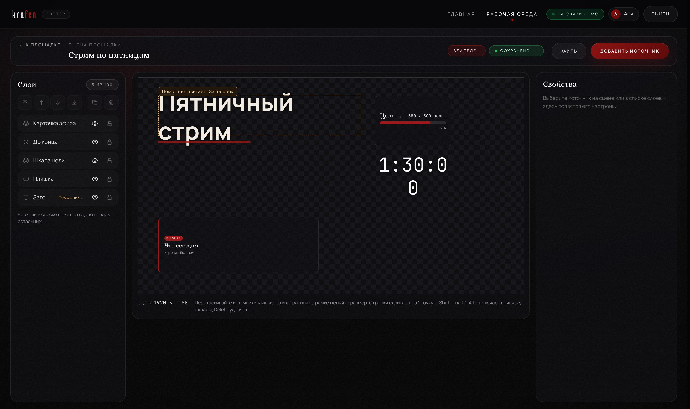 | 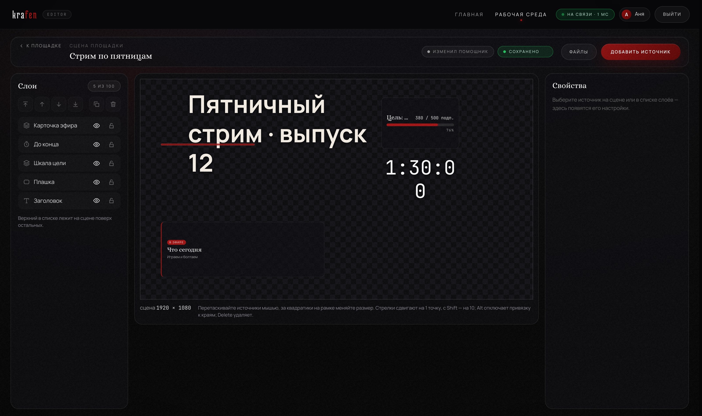 |
| 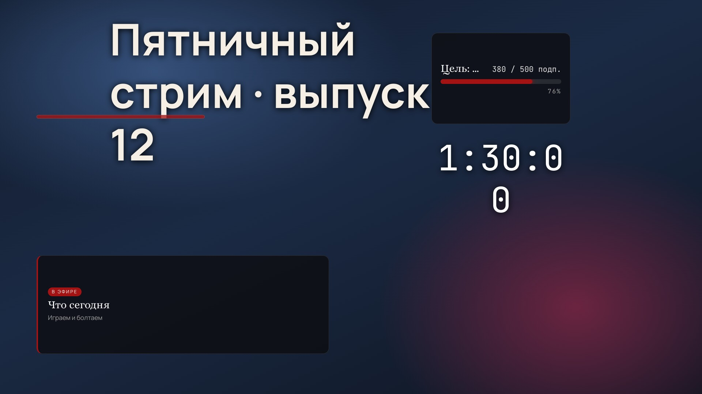 | 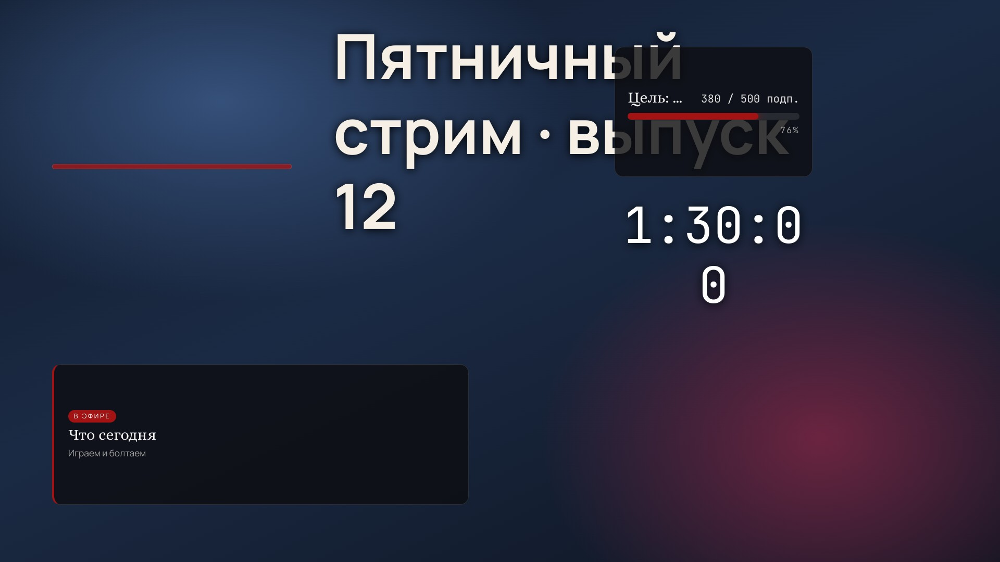 |
| 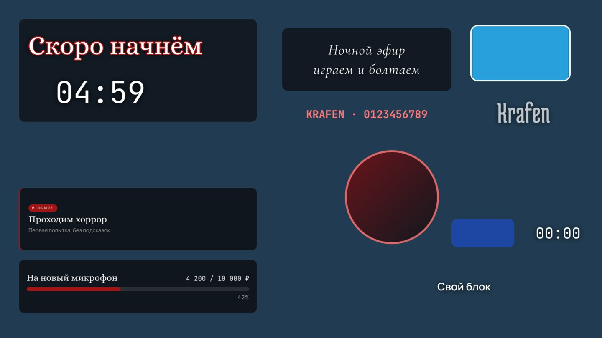 | 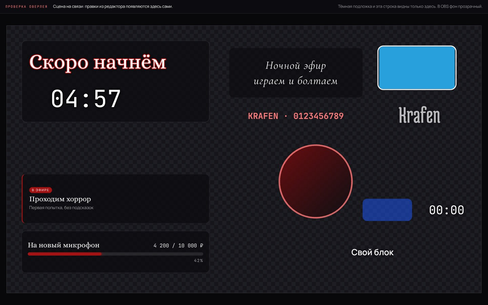 |
| 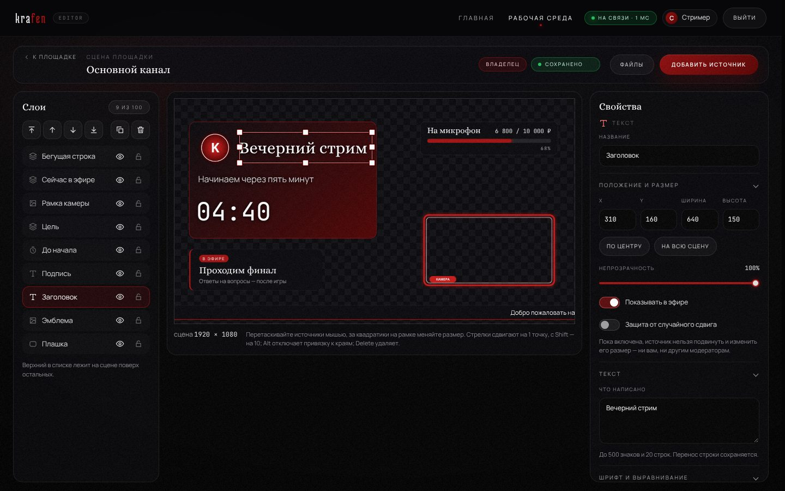 | 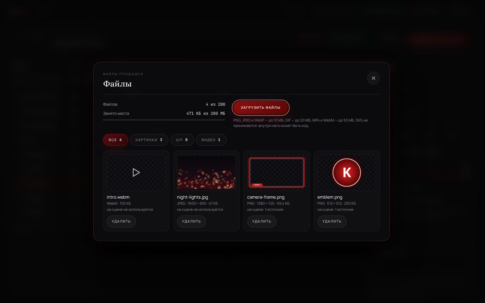 |
| 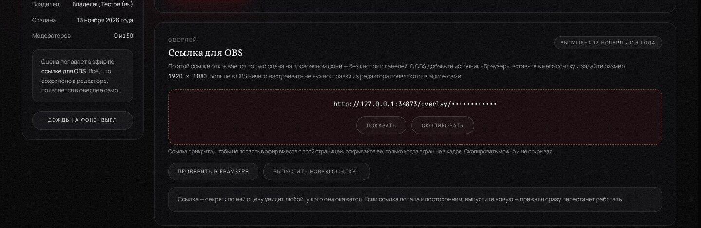 | 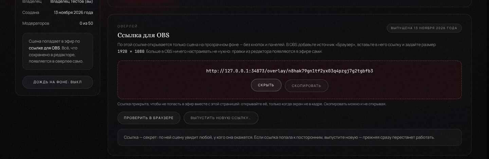 |
|  | 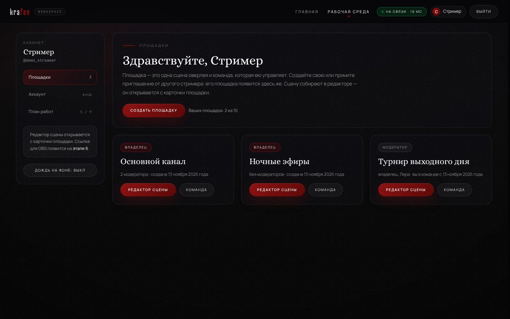 |
| 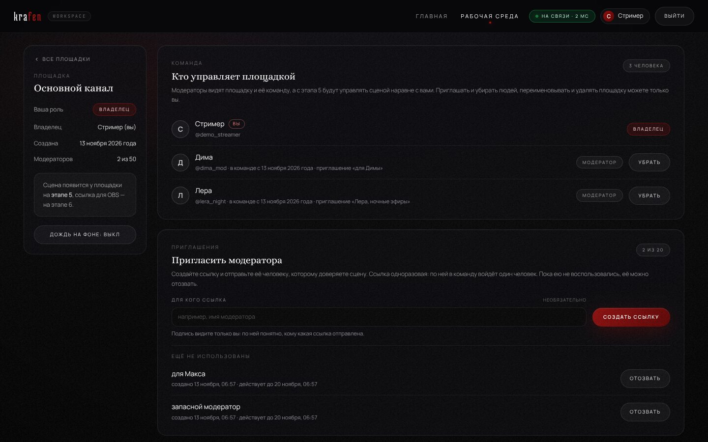 | 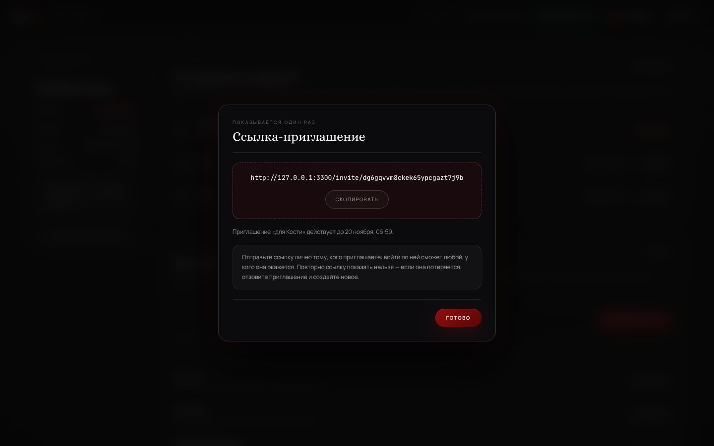 |
| 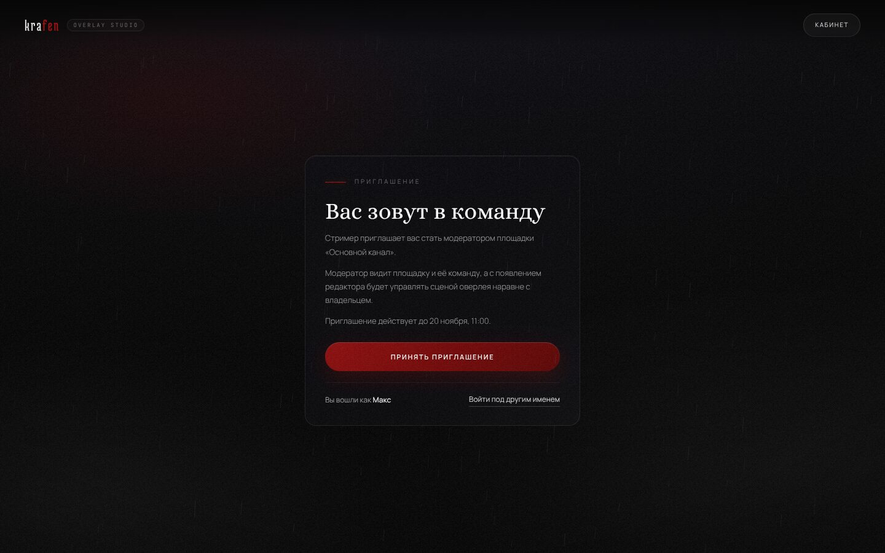 | 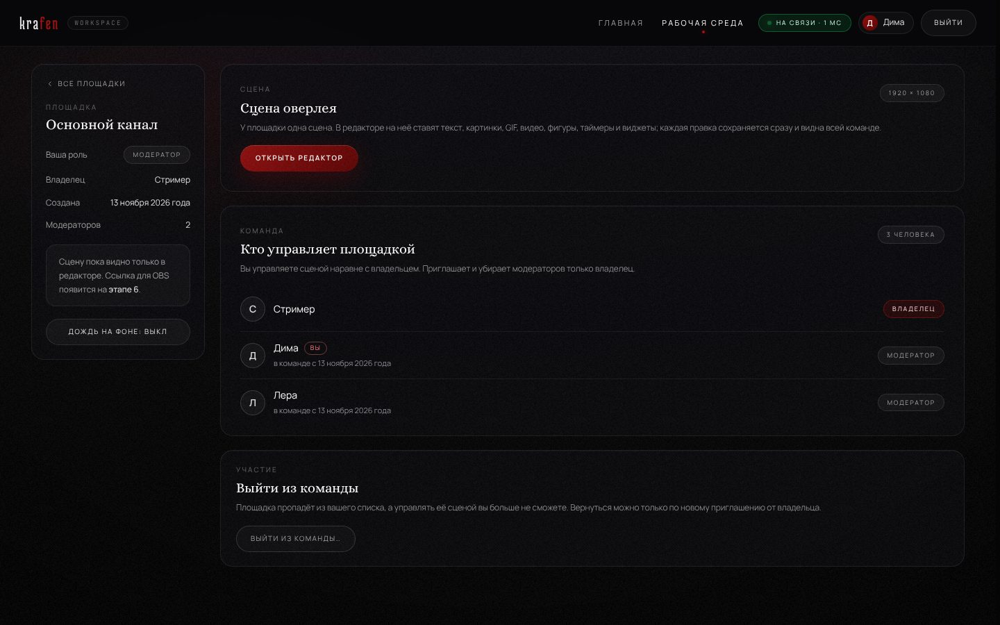 |
| 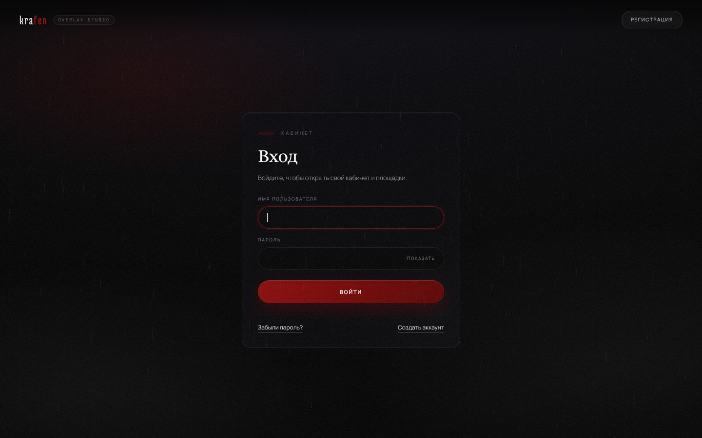 | 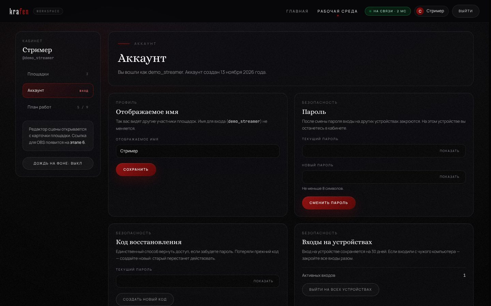 |

Ещё снимки: [окно «Добавить источник»](../docs/overlay-platform/screenshots/21-editor-add-source.jpg),
[регистрация](../docs/overlay-platform/screenshots/10-register.jpg),
[код восстановления](../docs/overlay-platform/screenshots/11-recovery-code.jpg),
[план работ — все девять этапов готовы](../docs/overlay-platform/screenshots/36-plan-vse-etapy.jpg),
[что уже работает](../docs/overlay-platform/screenshots/02-home-live.jpg),
[источники сцены](../docs/overlay-platform/screenshots/03-home-sources.jpg),
[элементы интерфейса](../docs/overlay-platform/screenshots/04-home-ui.jpg).
На телефоне: [главная](../docs/overlay-platform/screenshots/07-mobile-home.jpg),
[вход](../docs/overlay-platform/screenshots/13-mobile-login.jpg),
[кабинет](../docs/overlay-platform/screenshots/08-mobile-workspace.jpg),
[площадка](../docs/overlay-platform/screenshots/19-mobile-workspace-page.jpg),
[редактор](../docs/overlay-platform/screenshots/22-mobile-editor.jpg),
[свойства источника под сценой](../docs/overlay-platform/screenshots/23-mobile-editor-properties.jpg),
[кнопки слоёв в две строки по четыре](../docs/overlay-platform/screenshots/34-telefon-redaktor.jpg),
[кабинет на узком экране](../docs/overlay-platform/screenshots/35-telefon-kabinet.jpg).

## Запуск

Нужен Node.js версии 22.13 или новее. Сторонние сервисы и ключи не требуются.

```bash
cd overlay-platform
npm install
npm start          # http://localhost:3000
```

Настройки — в `.env.example`. Менять их не обязательно: без файла `.env` платформа
запускается со значениями по умолчанию.

| Настройка | Что делает | По умолчанию |
| --- | --- | --- |
| `HOST`, `PORT` | адрес и порт сервера | `0.0.0.0`, `3000` |
| `DB_PATH`, `UPLOADS_DIR` | где лежат база и загруженные файлы | папка `data/` |
| `TRUST_PROXY` | каким промежуточным серверам верить насчёт адреса посетителя | `loopback` |
| `REGISTRATION` | `open` — регистрироваться может любой; `closed` — никто | `open` |
| `SESSION_COOKIE_MODE` | `standard` — обычная работа; `embedded` — только для предпросмотра внутри чужой страницы | `standard` |
| `UPLOADS_TOTAL_LIMIT_MB` | сколько места на диске могут занять все загруженные файлы вместе, в мегабайтах | `5120` (5 ГБ) |

Опечатка в `REGISTRATION`, `SESSION_COOKIE_MODE` или `UPLOADS_TOTAL_LIMIT_MB` останавливает
запуск с понятным сообщением: сервер не подставляет значение по умолчанию молча.

**Для настоящего сервера** — отдельное руководство: [`docs/PUBLISH.md`](docs/PUBLISH.md).
Там `systemd`, Caddy с https, закрытие сервера от прямого доступа, обновление, копии
и восстановление.

## Аккаунты: что важно знать владельцу сервера

- **Почты у платформы нет.** Забытый пароль человек восстанавливает сам — кодом
  восстановления, который получил при регистрации.
- **Если потеряны и пароль, и код**, вернуть доступ может только владелец сервера.
  На сервере, в папке платформы:

  ```bash
  npm run account -- list               # список аккаунтов
  npm run account -- new-code <имя>     # выдать новый код восстановления
  ```

  Новый код передаётся человеку, и он сам задаёт пароль на странице «Восстановление
  доступа». Пароль при этом никому не становится известен.
- **Закрыть регистрацию** — `REGISTRATION=closed` в файле `.env` и перезапуск.
  Уже созданные аккаунты продолжают работать.
- **Счётчики попыток входа живут в памяти** и после перезапуска сервера начинаются заново.

## Резервные копии: что важно знать владельцу сервера

Копия снимается с работающего сервера, останавливать ничего не нужно:

```bash
npm run backup                      # копия в ./data/backups
npm run backup -- /путь/к/копиям    # или в указанную папку
npm run backup -- --check /путь     # проверить готовую копию
```

- в копию попадают **и база, и загруженные файлы**, о которых база знает;
- база копируется через `VACUUM INTO`, а не простым копированием файла: при обычном
  копировании теряются последние записи — они ещё лежат в `.db-wal`;
- файл, размер которого на диске не совпадает с записанным в базе, в копию не берётся,
  а в описи `backup.json` сказано, **какой именно и почему**;
- снятая копия сразу проверяется: открывается база, сверяется целость и наличие файлов.

**Копию нужно уносить с сервера.** Копия на том же диске не спасает от потери диска.
Как это делать автоматически и как восстанавливаться — в
[руководстве по запуску](docs/PUBLISH.md).

## Площадки и приглашения: что важно знать

- **Ссылку-приглашение платформа никому не отправляет.** Владелец площадки копирует её
  и передаёт человеку сам.
- **Ссылка показывается один раз.** Посмотреть её позже нельзя — в базе хранится только
  отпечаток. Потерянную ссылку отзывают и создают новую.
- **Пределы по умолчанию:** 10 своих площадок на аккаунт, 50 модераторов на площадке,
  20 неиспользованных приглашений одновременно, приглашение действует 7 дней.
  Они заданы в одном месте — `DEFAULT_WORKSPACE_LIMITS` в
  `src/server/workspaces/workspaces.js`.
- **Удалённую площадку вернуть нельзя.** Поэтому перед удалением страница просит набрать
  её название.
- **После перезапуска сервера** открытые страницы площадок переподключаются сами
  и перечитывают данные; заново входить не нужно.

## Редактор и файлы: что важно знать

- **Сцену пока видно только в редакторе.** Ссылка для OBS появится на этапе 6; всё, что
  собрано сейчас, останется на месте.
- **Отмены действия (Ctrl+Z) пока нет.** Удаление источника и файла редактор переспрашивает.
- **Пределы по умолчанию:** до 100 источников на сцене; до 200 файлов и 200 МБ на площадку;
  картинка до 10 МБ, GIF до 20 МБ, видео до 50 МБ; все площадки сервера вместе — 5 ГБ
  (`UPLOADS_TOTAL_LIMIT_MB`). Остальные числа заданы в одном месте — `DEFAULT_SCENE_LIMITS`
  в `src/server/scene/scene.js`.
- **SVG не принимается:** внутри такого файла может быть код. Файл с чужим расширением
  («программа.png») тоже не пройдёт — сервер смотрит на содержимое.
- **Файл, который стоит на сцене, удалить нельзя** — сначала его убирают из источников.
  Вместе с площадкой удаляются её сцена и все файлы.
- **Свой блок виджета — это HTML и CSS без скриптов.** Он показывается в отдельной рамке,
  где скрипты не выполняются, а с чужих сайтов ничего не загружается: сцену видят
  и модераторы, и OBS стримера.
- **В редакторе ролики всегда беззвучны.** Звук видео будет слышен только в эфире.
- **Загрузка по плохой связи:** если файл «завис» и минуту не приходит ни байта, сервер
  обрывает загрузку и освобождает место; на весь файл отводится до получаса.

## Проверка

```bash
npm test
```

Проверяются сервер, база, живой канал связи, страницы, шрифты, палитра и алгоритм зерна;
всё, что связано со входом: регистрация, вход и выход, восстановление доступа, защита
личных страниц, ограничение попыток, срок жизни входа и настройки запуска; и всё, что
связано с площадками: каждое действие от имени владельца, модератора, постороннего и гостя,
приглашения, пределы, живой канал площадки и обновление базы прошлого этапа; и всё, что
связано со сценой: источники и их настройки, права, приём и отказ файлов, пределы места,
одновременные загрузки, таймер, уборка файлов и то, что страница вставляет чужие данные
только как текст.

## Данные

База и загруженные файлы лежат в `data/`: база — один файл, файлы сцен — в `data/uploads/`,
у каждой площадки своя папка. Эта папка не попадает в репозиторий; для резервной копии
её нужно сохранять целиком.
В базе нет ни паролей, ни кодов восстановления, ни ключей входа, ни ссылок-приглашений —
только их необратимые отпечатки.

При обновлении платформы базу трогать не нужно: при запуске она сама достраивается
до нужного устройства, а уже сохранённые данные остаются на месте.
