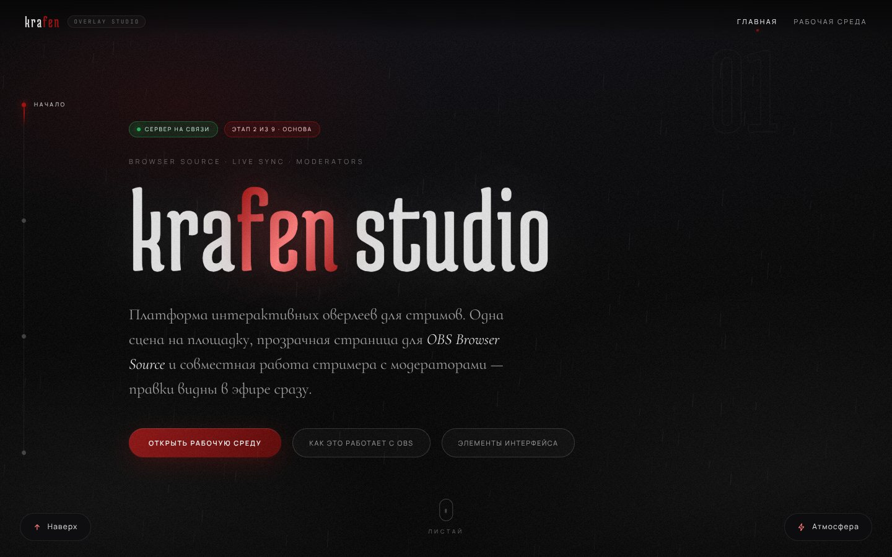
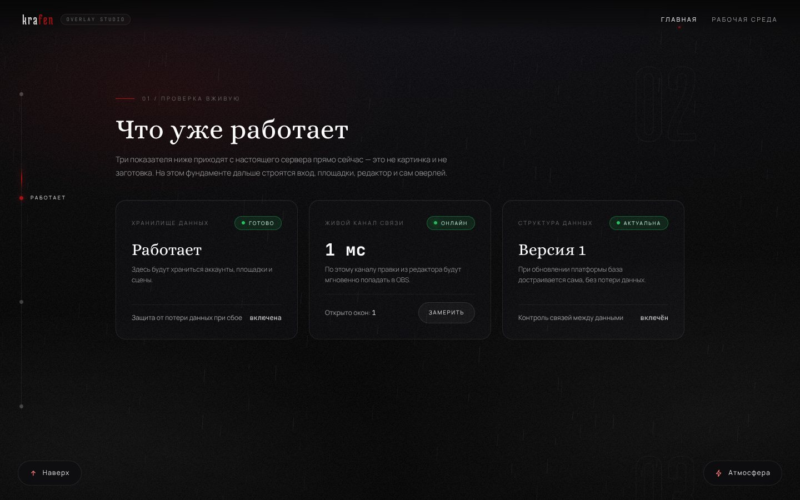
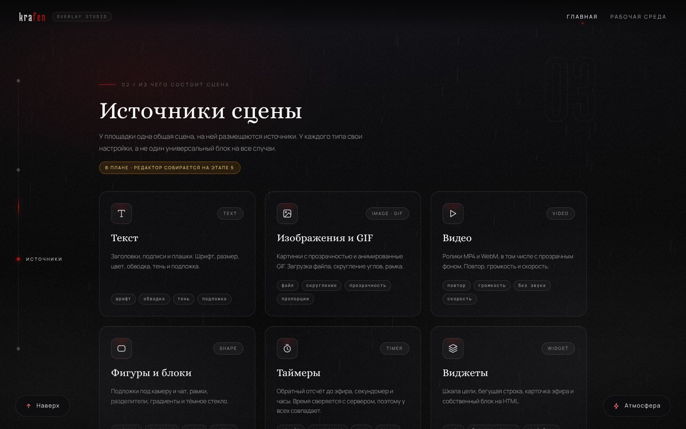
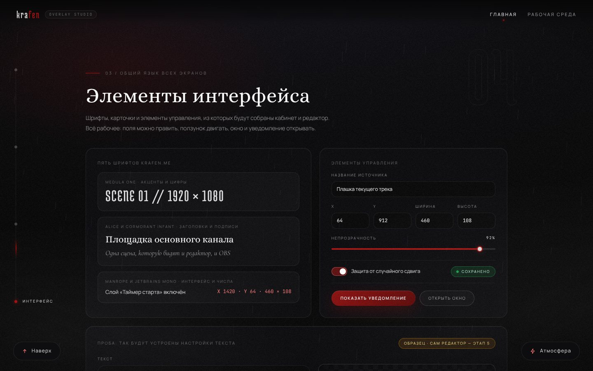
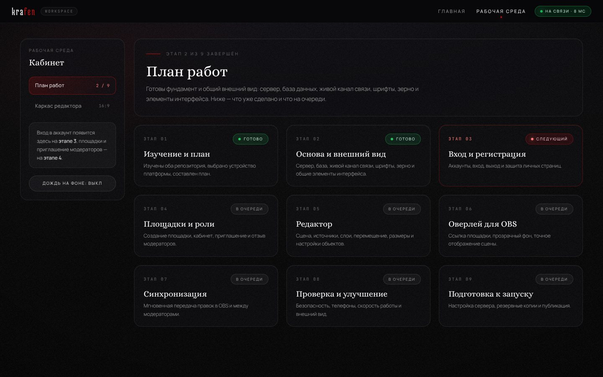
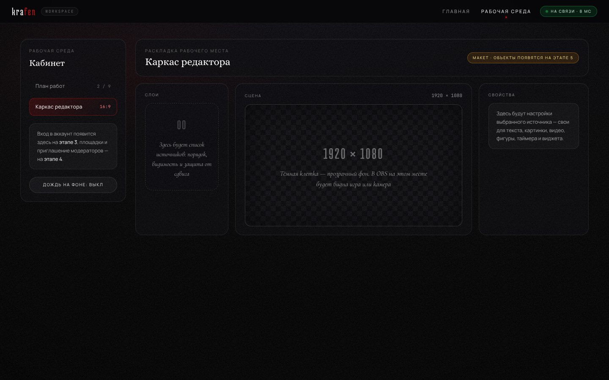

# krafen studio — платформа стрим-оверлеев

Веб-платформа для создания интерактивных оверлеев под OBS Browser Source. Внешний вид
продолжает [krafen.me](https://krafen.me/): тёмная палитра, зерно, стекло, багровые акценты.

**Состояние: в разработке, готов этап 2 из 9 (основа).** Входа, площадок, редактора
и самого оверлея пока нет — они появляются на следующих этапах.
План и устройство: [`docs/overlay-platform/ARCHITECTURE.md`](../docs/overlay-platform/ARCHITECTURE.md).

## Что уже работает

- сервер и база данных (один файл, данные переживают перезапуск);
- живой канал связи с автоматическим переподключением;
- дизайн-система: палитра и пять шрифтов `krafen.me`, зерно по алгоритму оригинала,
  дождь, туман, вспышки, карточки, кнопки, поля, окна, уведомления;
- главная страница с живыми показателями сервера и витриной элементов интерфейса;
- оболочка рабочей среды (`/app`) с планом работ и каркасом будущего редактора;
- адаптация под телефон, планшет и компьютер.

## Как это выглядит

| | |
| --- | --- |
|  |  |
|  |  |
|  |  |

На телефоне: [главная](../docs/overlay-platform/screenshots/07-mobile-home.jpg),
[рабочая среда](../docs/overlay-platform/screenshots/08-mobile-workspace.jpg).

## Запуск

Нужен Node.js версии 22.13 или новее. Сторонние сервисы и ключи не требуются.

```bash
cd overlay-platform
npm install
npm start          # http://localhost:3000
```

Настройки (порт, пути к данным) — в `.env.example`. Менять их не обязательно.

## Проверка

```bash
npm test
```

Проверяются сервер, база, живой канал связи, страницы, шрифты, палитра и алгоритм зерна.

## Данные

База и загруженные файлы лежат в `data/`. Эта папка не попадает в репозиторий.
